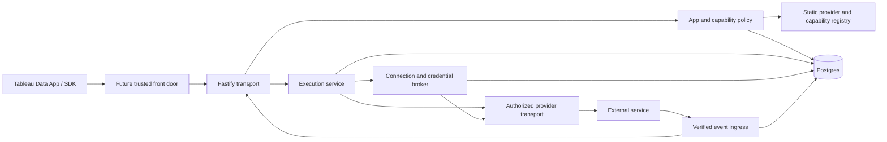

# Architecture proposal

Status: proposed design reviewed through three bounded agent rounds; not accepted by the user and not implemented.
[GOALS.md](GOALS.md) is the requirements baseline.
[Shared contracts](specs/contracts.md) resolve cross-component names and invariants.

## Scope and unresolved boundary

One internal solutions engineering team operates one service deployment for multiple configured Tableau Data Apps.
The service discovers capabilities, selects explicitly authorized connections, executes bounded provider operations, and delivers safe events.
An operation may need no external credentials, an app credential, or a delegated individual connection.
Those choices do not imply a new end-user account system.

App IDs and origins support configuration and browser restrictions, but prove neither app authority nor viewer identity.
A future trusted front-door adapter must create the app-scoped execution binding required by the domain contracts.
Selecting that adapter, registering callers and verifying Tableau/browser integration are intentionally deferred decisions.
Consequently these specs are sufficiently explicit for domain contract review, but not sufficient to launch a secure browser-facing service.
Support must be checked for each Tableau environment and version; Cloud and Server parity is not assumed.

## Composition

Use the selected strict TypeScript, Node.js LTS, Fastify, Postgres and Kysely stack.
Keep domain types independent of Fastify request objects and Kysely row types.
Start with a single deployed Node service and one Postgres database.
Bounded background work runs in the same service using database leases; multiple replicas can share this ownership model if deployment later requires them.
There is no dynamic plugin loader, job broker, separate event service, generic workflow engine, or provider runtime sandbox in this proposal.

The arrows identify responsibility dependencies; they do not grant arbitrary database access across modules.
Each module has an internal repository boundary and owns its table mutations.
Cross-module atomic work is exposed as a narrow transaction-aware operation owned by the participating modules, not direct SQL into another module's tables.
Foreign keys and uniqueness constraints protect references in addition to service checks.

| Component owner | Responsibility | Owned state | Narrow dependencies |
| --- | --- | --- | --- |
| App and policy module | Operator registration, capability allowlist, execution grants | App registrations and revisions | Static registry; connection authorization summaries |
| Provider and capability module | Static descriptors, protocol implementation, schemas and safe mapping | Reviewed source configuration; no mutable secret state | Brokered provider transport |
| Connection module | Authorization attempts, ownership, credential lifecycle, revocation | Connections, encrypted credentials, auth attempts, refresh leases | Protocol adapters; operator secret source |
| Execution module | Admission, idempotency, claims, dispatch intent, terminal outcomes | Executions, attempts, deduplication keys, opaque pagination references | Policy; connection broker; capability handlers |
| HTTP/SDK module | Envelope translation, browser contract, safe error presentation | No domain state | Trusted adapter; domain services |
| Event module | Verified ingestion, deduplication, routing, replay retention | Event subscriptions, receipts and delivery log | Provider verifier; policy and connection summaries |

## Consistency and failure model

Use database transactions for service-owned state changes and optimistic revisions or fenced leases for cross-request ownership.
Never hold a database transaction open while waiting for a provider network response or browser authorization.
Postgres commit and external provider effects cannot be one atomic transaction.
The execution and credential specifications therefore preserve uncertainty when an external effect may have occurred before the local result was recorded.
Retries depend on the declared operation and provider guarantee, not merely an HTTP timeout or a released worker lease.

App configuration revisions, connection generations and execution claim fences are independent protections.
Changing one does not revoke a request already accepted by a provider.
Read, discovery, execution polling, event replay and connection status each recheck current caller ownership and policy.
An in-flight result may be recorded after revocation for recovery/audit, but revoked callers cannot retrieve protected output.

## Configuration and operations

Operator-managed registration is the initial administration interface; these specs do not require an administration UI or public registration endpoint.
Configuration changes are validated and audited before becoming active.
Provider client secrets and credential-encryption keys are deployment secret references, not source-controlled app settings.
Choose a maintained secret-management and encryption library during implementation; do not invent cryptography or expose secret read APIs.
Logs contain app ID, internal binding ID where needed, execution ID, capability version, outcome code and timing, with bounded retention and access.
Do not log inputs, outputs, tokens, provider account IDs, authorization URLs, raw callbacks or provider error bodies by default.
Operator diagnostics use the same redaction rules; privileged database access is an operational trust boundary, not a browser feature.

Core metrics cover admission/dispatch counts, latency, queue age, refresh failures, unknown outcomes, rejected callbacks and event lag.
The initial implementation must choose storage retention and recovery operations before production use.
Proposed limits in the component specifications are review defaults, not measured capacity or user-approved service objectives.

## Extension and implementation readiness

The [core and provider specification](specs/core.md) describes adding a provider and capability without changing existing capability logic.
The [connection specification](specs/connections.md) owns credential behavior.
The [execution specification](specs/execution.md) and [HTTP/SDK/events specification](specs/http-sdk-events.md) own invocation and delivery.
[Scenario traces](specs/scenarios.md) cross those ownership boundaries.
[Decisions and open questions](decisions/0001-scope-and-boundaries.md) distinguish the user's direction from architecture recommendations and deferred choices.

The next implementation phase needs an accepted front-door contract, an environment compatibility check and a first concrete provider's documented authorization semantics.
It also needs actual tests, security review, migrations and operational recovery exercises.
Agent review checks specification coherence only and must not be presented as any of those activities.
