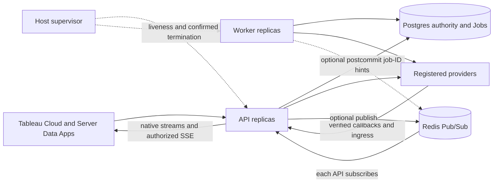

# Architecture

Status: accepted architecture direction with optional-Job and read-only routing revisions integrated.
Owner consistency and viewer checks cover this revision; historical independent reviews cover earlier snapshots, and runtime proof remains pending.
No application or deployment is implemented.
[GOALS](GOALS.md) owns product policy; the specifications below own mechanisms, and [verification](verification.md) owns future proof obligations.

## Application shape

One Node LTS/strict TypeScript/Fastify codebase has two independently replicable roles, initially one API and one worker.
Postgres is authoritative; optional Redis Pub/Sub distributes transient live events.
Correctness must hold with multiple replicas from the start, without a global exclusive authority row or singleton process assumption.

The API owns identity/session transport, native proxy, ordinary capability invocation, connection setup, explicit Job admission/inspection/cancel requests, verified callbacks and local SSE.
The worker owns core session/handoff/mutation maintenance and, when applicable, trusted in-process Job handlers, external observations and Job retention or configured source hooks.
Ordinary capabilities do not require worker dispatch, Job tables or live event transport.
Jobs remains the only queue; bounded Postgres scans recover committed work even when every optional hint is lost.
Redis never owns a session, credential, lock, job claim or result.
Disabling events creates no Redis client; a broker outage affects event readiness rather than core API readiness or durable callback processing.

## Ownership and interfaces

| Owner | Narrow responsibility/interface | State and failure boundary | Extension |
| --- | --- | --- | --- |
| Access | Verify identity/session; authorize current owner/site/shared audience and private disclosure. | Postgres owners, sessions and registry; absent/disabled authority denies. | Deployment-specific Cloud/Server adapters behind one verified identity contract. |
| Connections | Select, begin/complete setup through Credentials arbitration, reauthorize/replace/disconnect. | Stable personal/operator ownership, authority generation and setup reference to the exact reserved bundle; stale attachment cannot revive authority. | Shared setup adapters and actual provider context hooks. |
| Credentials | Scoped checkout and shared setup/import/renewal mutation arbitration/publication. | Encrypted coherent bundle, credential generation, one bounded per-connection reservation and revision-scoped uncertainty. | Documented safe recovery, proven independent explicit replacement or derived credential strategy. |
| Provider registry | Validate static definitions/configuration; resolve endpoints, own ordinary capability handlers and interpret external protocols. | Enabled registration/version compatibility; hooks return values, never mutate domain tables. | New declarative provider or narrow reusable protocol adapter. |
| Transport | Shared request/body resource scope, native streaming, guarded recipient and credential injection. | Live buffers/sockets only; interruption can leave remote effects. | Justified native transport support or guarded explicit redirect following. |
| Jobs | Admit, claim, settle, observe, cancel and disclose retained work. | Jobs metadata/payloads, immutable identity and terminal outcome; no interrupted submission replay. | Trusted versioned capability; optional child isolation if measured necessary. |
| Events | Verify source, publish transient envelope, reauthorize local delivery. | Durable source associations and bounded transient queues; loss has no replay. | Provider-specific verifier/lifecycle hooks. |
| HTTP / SDK | Shared wire codecs, handoff, native Response and explicit optional jobs/events. | Request/page-local state; no bearer from an unverified null origin or automatic business retry. | Framework-independent client use and proven browser transport adaptations. |
| Persistence / operations | Owner-specific Kysely adapters, scoped transactions, encryption, migration and lifecycle. | Postgres authority, protected keys and deployment budgets; failed conditional writes are explicit. | Owned schema additions and measured capacity changes. |

These are code responsibilities, not separate services or mandatory packages.
The composition root passes narrow ports and statically registers trusted modules.
Domain contracts expose neither Fastify request objects nor Kysely transactions to provider handlers.

## Identity and authority

Only server-verified deployment/site/user identity creates an owner.
Data App authors and users own app behavior; app IDs are configuration, defaults, attribution and submission namespaces, not package authentication.
Personal connections/jobs/events follow owner equality across configured apps, without personal app-use or feature grants.
Shared operator connections require explicit verified-site/user audiences, and personal users cannot administer their secrets.
The protected registry interface remains narrow; adding a site admits verified users but grants no shared connection access.
[Access](specs/access-connections.md) owns session lifetime, handoff and connection authority; the existing Cloud observation has limited scope and does not establish Server support.

[Ordinary snapshots](specs/persistence-operations.md#ordinary-request-snapshots) coherently read current authorization and the matching credential/context bundle without writes or policy shared locks.
Revocation committed before the snapshot denies; an authorized overlapping request may finish.
[Scoped ordered locks](specs/persistence-operations.md#transactions-concurrency-and-failure) remain for mutations, background checkout/start and final saved-result disclosure, including parent locks for absent audience membership.
No database transaction spans provider I/O.
A later disconnect cannot retract that snapshot or bytes already sent; every later operation needs its own current authorization.
Credential publication and original job outcome publication use different predicates so revocation cannot restore secrets or erase eligible results.

## Execution and recovery

Ordinary native requests and named HTTP capabilities run on the API using the same authorization/transport and return HTTP results directly.
Only explicit Job submission selects durable worker execution, saved input/results, progress, recovery and retention.
Capability naming, downloads and response size alone never choose durability.
For deliberate Jobs, first start fixes the execution deadline; a persisted external ID permits observation without another submission.
Lost initial execution ownership, including claim-before-invocation, produces interruption rather than automatic requeue.
A task accepted remotely before its ID is persisted may have an unknown external outcome.
Verified callbacks use Jobs directly, with or without Redis.

Trusted Job handlers initially share the worker process; ordinary capability handlers share their API request process and its normal drain/liveness behavior.
Reserved control scheduling and database capacity handle expiry, cancellation, observations and recovery independently of handler slots.
A never-settling Promise and a blocked event loop require different detection paths: attempt cleanup deadlines and an external host responsiveness watchdog.
Stop claims, force termination when necessary and confirm process exit before reusing its capacity.
Worker-wide replacement can interrupt siblings and delay maintenance; that tradeoff is accepted, while its runtime behavior remains unverified.
Per-attempt child processes are an extension if mixed-load evidence shows unacceptable disruption, not the initial topology.
[Execution](specs/providers-execution.md) owns claims, cancellation races, external observation and bounded cleanup.

### Worker deployment recommendation

Retain the accepted initial API plus worker topology in this revision: core session/handoff/mutation expiry cleanup and interrupted credential recovery need an owner even without Jobs.
Disable empty Job scans when no configured enabled Job entrypoints accept submissions and no unfinished/retained rows remain; run source hooks only for configured integrations.
Manual event sources and Redis/SSE delivery do not require a background Job executor.
No Job leases, handler slots or Job watchdog checks are readiness prerequisites for ordinary routing/capabilities.
Core maintenance uses bounded due scans and conditional state transitions, not dummy Jobs.

Recommendation, not an adopted topology change: a native-only deployment could run the same bounded core maintenance hooks on API replicas and omit the worker until durable work or source hooks are enabled.
That removes a process but places maintenance scheduling/load and recovery readiness on the API; it needs an explicit deployment choice and evidence that cleanup progresses under request load.
No separate coordinator, scheduler service or new recovery product is needed in either placement.
This recommendation does not block the accepted specification edits or authorize implementation.

## Live events and native streams

Every API subscribes to deployment-scoped Redis channels before it reports event readiness and uses one receive path, including for locally published events.
Published audiences are hints; current source revision, session and personal/shared audience are checked before enqueue and logical delivery.
One logical payload cap, derived encoding budgets, age limits and independent queue limits prevent valid ingress from exceeding a smaller forwarding allowance.
Reconnect clears obsolete buffers and signals possible loss; no archive, durable delivery, second event transport or automatic ambiguous publish retry is added.
[Events and wire contracts](specs/events-http-sdk.md) own these details.

Native HTTP streams use the normal authenticated proxy, with no event envelope or arbitrary total response cap.
The transport preserves encoded bytes and representation headers, supports browser POST carriers for GET/HEAD bodies and exposes provider redirects through an explicit no-follow response carrier.
Maintained libraries enforce approved recipient routing, verified TLS and secret-bearing header protection, including deliberately configured private destinations.
Native provider-created credentials are permitted output; entrusted stored or helper-derived authenticators remain private.

## Operations and support boundaries

Measure large JSON parsing/canonicalization/encryption/driver copies alongside long streams before choosing physical capacity.
Reserve resources before accumulation; authorize before loading saved private Job payloads and recheck their disclosure without long authority locks.
Ordinary HTTP responses retain their request snapshot boundary rather than inheriting saved-result disclosure transactions.
Budget database connections across all replicas, control reserves, maintenance and replacement overlap.
Use one migration owner, compatible code/schema, in-flight HTTP version draining and active Job capability versions; incompatible changes and offline rekey stop all writers and automatic restart.
No selected host, traffic level, SLA, price or slot count is implied.
[Readiness](implementation-readiness.md) maps these contracts to future evidence; design acceptance and document review do not establish operational support.
