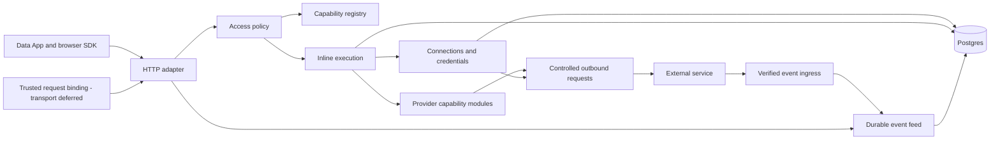

# Architecture proposal

Status: independent initial proposal.
The requirements and unresolved dependencies are in [goals-assessment.md](goals-assessment.md).
The shared vocabulary and proposed domain interfaces are in [specs/contracts.md](specs/contracts.md).

## Application shape

The service mediates between configured Data Apps and registered external capabilities.
It performs five steps for an invocation: establish authority, resolve the configured capability and identity, obtain usable credentials when needed, execute bounded provider requests, and record a safe outcome.
It separately receives verified external events and makes permitted notifications available to Data Apps.

The diagram shows logical responsibilities in one application.
Postgres owns durable coordination, encrypted secret records, receipts, and event replay.
No broker, scheduler, separate runner, dynamic code loader, or internal RPC is required initially.
Provider modules are trusted reviewed application code, not untrusted hosted functions.

## Owners and interfaces

| Owner | Owns | Public domain seam | Must not own |
| --- | --- | --- | --- |
| Access | App registrations, enabled capabilities, service bindings, verified holder policy. | Resolve and authorize a request context. | Provider credentials or local human profiles. |
| Connections | Connection authority, authorization transactions, external subject association, disconnect. | Begin/inspect authorization, resolve a permitted connection, disconnect. | HTTP sessions or arbitrary caller-selected identity. |
| Credentials | Encrypted material, expiry, renewal attempts, credential revisions. | Supply scoped outbound authorization for an approved connection. | Capability business behavior or HTTP responses. |
| Capability registry | Immutable versioned schemas, identity, effect, permissions and limits. | Discover permitted definitions and resolve an exact version. | Mutable credentials or execution state. |
| Execution | Admission, command deduplication, deadlines, effect evidence, receipts. | Invoke and inspect an authorized operation. | General background work or provider-specific compensation. |
| Provider modules | Protocol mapping, endpoint policy, permission evidence, capability handlers, event interpretation. | Registered provider hooks and handlers. | Connection-use policy or database access. |
| Events | Verified ingress admission, deduplication, audience routing, durable replay. | Accept a verified event and read an authorized feed. | Arbitrary workflows or implicit capability execution. |
| HTTP/SDK | Wire validation, binding adapter integration, serialization, browser lifecycle. | The versioned client API. | Credential refresh logic or authority inferred from an origin. |
| Persistence | Transactions, constraints, encrypted storage and conditional updates. | Owner-specific repositories. | A second copy of domain policy. |

Owners are code responsibilities, not proposed staffing or service boundaries.
A small composition root constructs these modules and passes explicit dependencies.
Keep Fastify request/reply objects and Kysely transaction types out of domain interfaces.
Share a transaction only where an invariant spans persisted records; do not build a generic repository or event bus framework.

## Identity and authority

An app identifies the configured Data App for policy and attribution.
A holder identifies a verified execution binding entitled to use a delegated connection; it need not be a named person or local account.
An external subject identifies the provider account that authorized a connection.
These identifiers have different meanings and are never interchangeable.

Every browser request needs a verified app context, even if the requested capability uses no external credentials.
A delegated capability additionally needs a holder that the trusted boundary can prove on subsequent requests.
The service stores only the opaque holder association required for authorization, without creating a user profile.
External account authentication does not itself prove the app or grant unrelated connection-use authority.

A capability has one fixed execution identity: none, service, or delegated.
The app configuration explicitly selects a service connection for a service capability.
A delegated connection must match both app and holder, plus the capability's provider registration and required permission evidence.
There is no caller-selected fallback order among identities.
Where a provider supports an individual action with delegated authorization, the capability uses delegated identity.
An intentionally service-owned operation is a separately described capability with explicit app policy.

## Persistence and concurrency

The database records facts needed to protect authority and recover from interruptions, not a general execution graph.
Short transactions establish ownership and state transitions before network effects and commit results afterwards.
No database transaction remains open while waiting for a provider response.
Conditional updates check the connection authorization epoch, credential revision, operation claim, and current app policy where relevant.

Disconnect commits a terminal connection state and increments its authorization epoch before cleanup.
An old refresh result cannot recreate or reactivate that connection.
A credential renewal attempt records whether the provider request may have been sent.
An expired claim is evidence that local work stopped being supervised, not evidence that the provider did nothing.
An invocation receipt likewise distinguishes a failure known to have no effect from an uncertain or partial external write.

Current authority is checked before each provider dispatch and before exposing a receipt, event, or result.
Revocation prevents future admission; it cannot retract a request already admitted for network dispatch or an effect already applied by the provider.
The exact admission point and this race limit are part of the contract, not an implied guarantee of instantaneous remote cancellation.

## Extension path

Adding a provider registers its configuration schema, authorization methods, credential validation and renewal hooks, endpoint rules, and optional event verifier.
Adding a capability registers its exact public contract and a handler using the scoped outbound request seam.
Neither change needs new tables, routes, browser credential logic, or edits to existing capability handlers for already supported lifecycle behavior.
A genuinely new authorization protocol may require a new reusable protocol adapter; it still uses the existing connection authority and lifecycle.
A capability needing durable work after the request ends requires a separate design decision with restart and cancellation semantics.

The module contracts are detailed in [specs/access-connections.md](specs/access-connections.md), [specs/providers-execution.md](specs/providers-execution.md), and [specs/events-http-sdk.md](specs/events-http-sdk.md).
Storage and operational ownership are in [specs/persistence-operations.md](specs/persistence-operations.md).
Material alternatives and deferred scope are in [decisions/choices.md](decisions/choices.md).
