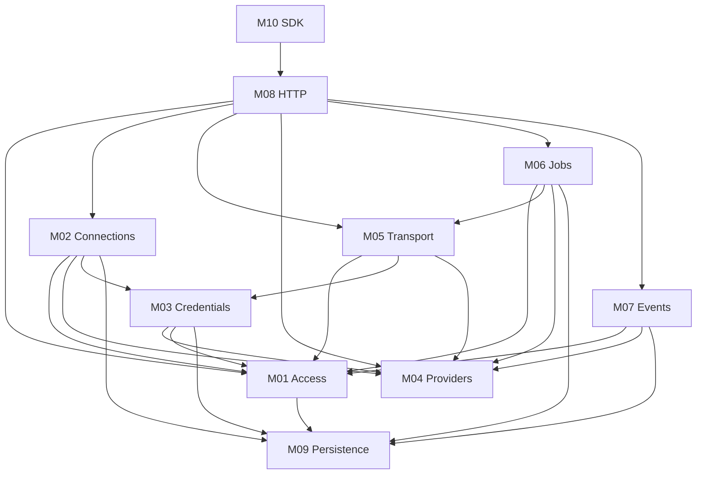

# Module design

Status: specified responsibility map for one accepted codebase, not separate services or implemented modules.
[Architecture](../architecture.md) owns topology; each linked component owns normative behavior.
The composition root statically registers trusted modules and passes narrow ports, keeping Fastify/Kysely types and server secrets out of handler/public SDK contracts.

## Dependency direction

These arrows represent narrow supplied ports, not permission to import entire owners or create dependency cycles.
M09 implements owner-specific adapters and transaction primitives rather than a generic business-logic superclass.

## Module contracts

### M01 - Access

**Owns:** verified deployment/site/owner mapping, sessions, site registry, explicit shared audiences and current disclosure.
**Input:** supported adapter evidence or presented session/registry proof plus requested resource/configured app context.
**Output:** verified AccessContext/current request snapshot or typed denial, never browser-constructed authority.
**Read path:** M01-M03 supply their predicates to one M09 projection, reused through handoffs without repeated SQL or policy locks for ordinary usable-bundle calls.
**Interfaces:** `authenticate`, `authorizeConnectionUse`, `authorizeDisclosure`, `checkSite`, `registerSite`, `setSiteEnabled` under [Access](../specs/access-connections.md).
**State:** owner/session/proof verifiers, deployment/site parents and shared membership; no feature grants or personal app bindings.
**Invariant:** owner equality across configured apps and explicit shared sites/users; app IDs/null origins do not authenticate packages.
**Failure/recovery:** expiry/disablement denies future checks; restoration cannot mint bearer from a cookie for any null-origin requester.
**Extension:** Cloud/Server identity adapters behind one verified identity contract, without local accounts or automatic linking.
**Holds:** D01/E01 returning-client binding and actual Cloud/Server journeys remain unverified; viewer equality is not required.

### M02 - Connections

**Owns:** setup/import, selection, same-account reauth, explicit replacement/disconnect and atomic credential/context association.
**Input:** current personal/operator authority, provider-declared input and optional expected generation/replacement intent.
**Output:** safe connection/attempt view or current ConnectionUse.
**Interfaces:** `begin`, `authorizeLaunch`, `complete`, `importStatic`, `selectVisible`, `reauthorize`, `replace`, `disconnect` under [connection lifecycle](../specs/access-connections.md#connection-selection-and-state).
**State:** immutable owner/provider, authority generation, safe account evidence and single-use browser/protocol setup transactions referencing the sole Credentials mutation owner; expected pair/processor state is not duplicated.
**Invariant:** proven same-account reauth can preserve authority generation; unknown/new identity cannot inherit old jobs.
**Failure/recovery:** competing setup/import fails before provider work; stale completion cannot attach, and interrupted possibly-invalidating setup uses revision-scoped recovery without poisoning a newer independent bundle.
**Extension:** shared OAuth/static/operator flows and required context/discovery hooks only.
**Holds:** D08 provider continuity evidence and actual setup/reauthentication tests.

### M03 - Credentials

**Owns:** entrusted authenticators, coherent checkout, shared setup/import/renewal mutation arbitration, dispatch uncertainty and credential generation.
**Input:** internal current ConnectionUse, operation deadline/signal and live claim when applicable.
**Output:** scoped immutable credential/context snapshot or explicit renewal/reauthentication failure.
**Interfaces:** `withCredentials`, `reserveMutation`, `claimMutationStep`, `markMayHaveDispatched`, `publishBundle`, `recoverMutation` under [credential mutation arbitration](../specs/access-connections.md#competing-credential-mutations) and [renewal](../specs/access-connections.md#refresh-coordination-and-interruption).
**State:** encrypted bundles and one bounded mutation representation for setup/import/renewal with provider interaction; strictly local imports have no persistent processor claim, lease or recovery phase.
Strictly local candidates prepare outside locks, then the same writer checks current authority, exact expected generations and no competing reservation/uncertainty barrier in one atomic publication transaction; stale candidates conflict without replay.
**Invariant:** publication checks current authority and exact captured generations; provider-interacting work additionally requires its current reservation/live processor, while local import requires no competing reservation or uncertainty barrier.
Credentials/context publish together, stale recovery cannot poison newer material, and refresh never resets explicit connector reauth.
**Failure/recovery:** pre-dispatch abandonment preserves the bundle; possible invalidation retains a revision-scoped unusable barrier until provider-supported recovery or proven independent explicit replacement, without locks across network/browser waits.
**Extension:** maintained protocol primitives and narrow supported derived/signing/rotation hooks.
**Holds:** D06 real race/lease tests and D08 provider semantics, not a new topology choice.

### M04 - Provider registry

**Owns:** static definitions, supported schemas/protocols, endpoints, injection strategy and optional HTTP capability handlers/Job entrypoints/source hooks.
**Input:** operator configuration and validated connection context.
**Output:** approved endpoint/strategy descriptors, declared ordinary JSON/native Response or validated background hook data for core publication.
**Interfaces:** `validateRegistration`, `resolveEndpoint`, `parseBundle`, optional `discoverContext`, `invoke` inside the API request, task interpretation and source verification under [providers](../specs/providers-execution.md#provider-registration-and-shared-flows).
**State:** immutable revision-keyed code/configuration in memory, no capability execution rows or direct SQL in hooks; drain HTTP calls and retain Job versions only as long as their durable obligations.
**Invariant:** configuration cannot redirect old credentials or create provider permissions; intentional native new credentials remain allowed output.
**Failure/recovery:** unsupported mode/protocol fails explicitly; ordinary abort/error closes its request with no replay, saved outcome or automatic Job promotion; incompatible identity/destination changes fence affected authority.
**Extension:** ordinary providers add declarations/fixtures, and actual protocol differences add narrow reusable hooks.
**Holds:** E03 supported provider facts and active-version upgrade tests.

### M05 - Transport

**Owns:** guarded recipient/TLS/header injection, native byte streaming, no-follow responses, backpressure and the common request/operation/body resource scope.
**Input:** currently authorized native request and coherent endpoint/credential snapshot.
**Output:** native status/useful headers/stream or precommit service error and postcommit body failure.
**Interfaces:** `request` and guarded connector through [native transport](../specs/providers-execution.md#native-forwarding-and-transport).
**State:** bounded live bytes/sockets, no ordinary proxy body archive or job receipt.
**Invariant:** no arbitrary credential recipient or automatic business replay; no arbitrary total response cap or full-body buffering.
**Failure/recovery:** abort/stall closes local work without remote rollback; ordinary output remains in its HTTP scope through body completion, and background bodies remain in their attempt scope until disposed.
**Extension:** deliberately configured private providers and justified transport/redirect support with per-hop checks.
**Holds:** D04 native carrier/media/browser/ingress proof and E04 measured physical budgets.

### M06 - Jobs

**Owns:** explicitly requested durable admission, scheduler, execution/observation/cleanup claims, callbacks, cancellation races, retained disclosure and payload ownership.
**Input:** explicit durable choice/current submitter, semantic command/key, original connection generation or verified callback evidence.
**Output:** committed JobView/result or explicit conflict/stale/interrupted outcome.
**Interfaces:** `admit`, `claimStart`, `attachExternalTask`, `observe`, `applyVerifiedCallback`, `listOwnVisible`, `getResult`, `requestCancel`, `recoverDue` under [Jobs](../specs/providers-execution.md#durable-admission-and-execution).
**State:** indexed metadata plus separate encrypted payloads; prebound correlation and bounded remote-cancel issued status only for supported hooks.
**Invariant:** Postgres scheduling discovers work without Redis wakeups; no initial-claim replay; current credential revocation differs from eligible original result publication.
**Failure/recovery:** expired initial claims interrupt, persisted external waits resume their supported tracking path, and first eligible terminal commit wins.
**Extension:** static capability/version; per-attempt children only if measured worker-wide disruption requires isolation.
**Holds:** D02/D07 real multi-replica races, host termination and mixed-load proof; accepted sibling interruption is not awaiting product approval.

### M07 - Events

**Owns:** source verification/lifecycle, optional Redis Pub/Sub, current local audience checks and lossy browser SSE.
**Input:** bounded verified provider bytes or postcommit opaque job-ID hint.
**Output:** bounded versioned envelope and current-authority live delivery/drop.
**Interfaces:** `verifyIngress`, `publish`, `subscribe`, `authorizeDelivery`, `maintainSource`, `retireSource` under [Events](../specs/events-http-sdk.md#redis-transport-and-live-sse).
**State:** durable source/audience/claim metadata plus transient bounded broker/API queues, never event payload rows.
**Invariant:** disabled means no Redis client; outage affects events only; every API receives through its subscriber and rechecks authority before logical delivery.
**Failure/recovery:** loss/reconnect clears obsolete buffers and signals resync; ambiguous source mutation needs safe recovery or attention.
Source health/renewal deadlines are distinct from provider-specific event validity, checked at ingress/enqueue/delivery independently of delayed maintenance; subscription expiry alone does not discard a valid signed delayed event.
**Extension:** only provider-needed verification/lifecycle hooks; no mandatory dedupe or replay platform.
**Holds:** E02/E04 broker loss/age/encoding/backpressure/ACL and source-uncertainty tests.

### M08 - HTTP adapters

**Owns:** routes, boundary schemas, auth transport, CORS, shared carrier codec/profile, origin/error integrity and streaming handoff.
**Input:** untrusted HTTP with distinct browser, callback, registry and source proof classes.
**Output:** [wire contracts](../specs/events-http-sdk.md#proposed-http-surface) and [API map](api-design.md).
**Interfaces:** thin validated adapters to the owning module; shared login/provider handoff implementation.
**State:** request IDs, bounded parsing/buffers and local transports; no independent domain database.
**Invariant:** CORS/null origins never create identity; adapter-owned provenance marks constructed/transformed output service-origin and unchanged transport pass-through provider-origin.
The shared carrier permits service-origin Responses only on A39; headers/bytes remain consistent and no error instructs automatic replay.
**Failure/recovery:** distinguish service/provider/unmarked HTTP, precommit rejection and late body failure.
**Extension:** shared routes expose new registrations without per-endpoint controllers or approval screens.
**Holds:** D01 restoration binding and D04 actual package/header/media behavior.

### M09 - Persistence and operations

**Owns:** owner-specific Kysely adapters, scoped ordered locks, encryption, resource/pool budgets, migration/readiness/rekey and host lifecycle integration, including the small shared worker execution-lifetime helper.
M05 supplies transport/body disposal; Jobs and Events own their respective domain claims/transitions and can use the helper independently, without a generic task framework.
**Input:** typed owned operations with expected claims/generations and protected configuration.
**Output:** committed or explicit stale/failure result; distinct core/event readiness and liveness.
**Interfaces:** coherent request/read projections, named mutation/disclosure transactions, bounded core maintenance, `migrate`, `readiness`, `reencrypt` under [operations](../specs/persistence-operations.md).
**State:** authoritative Postgres schema and protected host keys; no Redis authority or global guard.
**Invariant:** zero-write ordinary snapshots with current mutable authority; fresh database time after waits and parent audience locks for transactions, no large work under authority locks and no zero-row success.
**Failure/recovery:** core expiry/mutation recovery without Jobs, conditional Job/source scans and confirmed host termination for background attempts; compatible overlap or all-writer downtime for incompatible migration/rekey.
**Extension:** concrete owned schema additions and measured capacity changes without a new platform.
**Holds:** D06/E04/E05 real database, whole-deployment pool, shutdown and interrupted-rekey proof.

### M10 - Browser SDK

**Owns:** one thin framework-independent client, shared session/handoff, carrier reconstruction and optional jobs/events.
**Input:** service/app configuration, current verified authority and native request fields.
**Output:** Response/stream and generated safe service-resource types.
**Interfaces:** `request`, `invoke`, `connect`, `importStatic`, `disconnect`, `submitJob`, `listOwnJobs`, `getJob`, `getResult`, `cancelJob`, `subscribe` and proven session methods under [SDK](../specs/events-http-sdk.md#embedded-browser-sdk).
**State:** page-local access and explicit submission recovery data; restoration transport remains evidence-dependent.
**Invariant:** no entrusted secret export, automatic business retry, universal provider schema or default whole-body parsing.
**Failure/recovery:** explicit auth/gesture/denial states, resync after event loss and current-owner retained-job rediscovery.
**Extension:** direct package inclusion and framework adapters without another authentication extension.
**Holds:** D01/E01 Cloud/Server sessions and D04 media/carrier evidence.

## Proposed source layout

One codebase may use `runtime`, `access`, `connections`, `credentials`, `providers`, `transport`, `jobs`, `events`, `http`, `persistence` and `commands` directories, plus browser SDK, migrations and tests.
These are responsibility labels, not ten packages or application files created by this design exercise.
Generate only shared service-resource types, not every native provider API.

## Adding work without changing the core

| Addition | Expected edits | Reuse/proof |
| --- | --- | --- |
| Ordinary provider | Declarative schemas/endpoints/protocol and fixtures. | Existing lifecycle/routes/transport; second-provider native proof early. |
| Account-specific destination | Validated context/discovery and routing fixtures. | Atomic bundle publication and guarded connector. |
| Ordinary capability | Versioned input/response and trusted HTTP handler in M04. | Existing request authority/helpers/stream cleanup; no Jobs or persistence. |
| Durable capability entrypoint | Explicit Job handler and only necessary task hooks. | Owned Jobs, original authority, background cleanup and retention. |
| Events | Verified source/routing/setup ownership and necessary hooks. | Optional Redis, one payload contract and current local SSE delivery. |
| Another Data App | Config/defaults/attribution. | Existing personal ownership and explicit operator audience; no personal app-use grant. |
