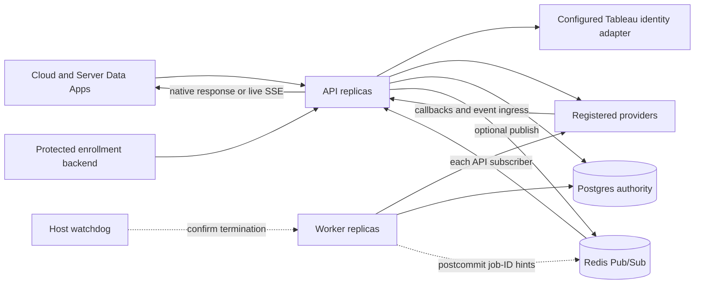
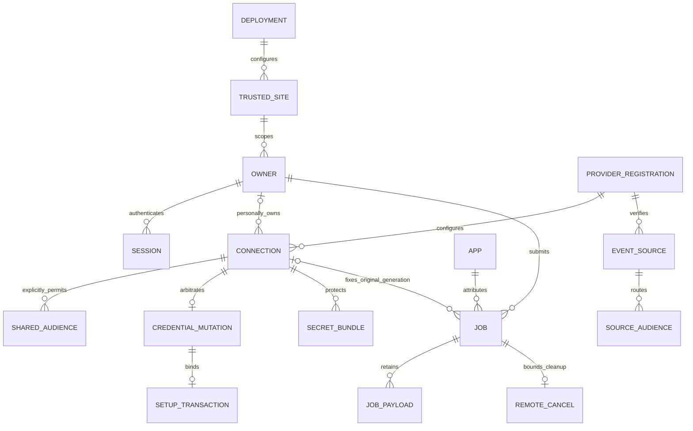

# System design

Status: accepted two-role architecture; operational/platform proof remains outstanding.
This document maps [architecture](../architecture.md) and [persistence](../specs/persistence-operations.md), which own the actual topology and state contracts.

## Runtime view

Initially one API and one worker share the same Node LTS/strict TypeScript/Fastify codebase, but all persisted authority and claims work across replicas.
Postgres owns durable truth and coordination; Redis is an optional transient plaintext boundary for live events only.
When disabled there is no Redis client, and when unavailable core API/Jobs/callback readiness remains independent.
No selected hosting platform, traffic assumption, SLA or price follows from this topology.
The [worker placement recommendation](../architecture.md#worker-deployment-recommendation) distinguishes required core maintenance from optional background execution without silently changing the accepted initial topology.

## Process boundaries

| Component | Work | Invariant/recovery | Extension |
| --- | --- | --- | --- |
| API replicas | Sessions, connections, native streams, ordinary capabilities, explicit Job admission/private reads, callbacks and local SSE. | Every API subscribes when events enabled; callback commit never depends on publish success. | Replicate under shared authority contracts. |
| Worker replicas | Core expiry/mutation maintenance plus enabled or outstanding Job handlers/observations/retention and configured source hooks. | Bounded scans cannot strand work; reserved control resources and host termination prevent false slot reuse. | Per-attempt children only if measured disruption warrants isolation. |
| Postgres | Sessions, encrypted bundles, optional Jobs/payloads, source/audience state and coordination. | Coherent ordinary read snapshots; scoped mutation/background/disclosure locks and live predicates, no global exclusive authority row. | Owned migrations for concrete state. |
| Redis when enabled | Transient Pub/Sub messages and optional job-ID hints. | Loss on outage/reconnect; no locks, replay/outbox, result storage or second relay. | Stronger delivery would require a new justified contract. |
| Host supervisor | Independent liveness and bounded process termination/replacement. | Dependency outage differs from event-loop hang; confirm exit before capacity reuse. | Actual host selected and tested later. |
| Commands | One migration owner and offline rekey with writers/restart stopped. | No automatic per-replica migrations or false success. | Ordinary versioned tools only. |

## Trust and data classification

| Boundary/data | Producer/consumer | Enforcement | Persistence |
| --- | --- | --- | --- |
| Verified identity | Supported Cloud/Server adapter to Access. | Deployment/site/stable subject, never browser claims or email linking. | Minimal owners/sessions and fixed authentication time. |
| Browser authority | Service session to HTTP/Access. | Bearer plus current site/resource checks; null origin is not identity. | Session/proof verifiers, no reusable bearer in jobs/URLs. |
| Registry management | Protected enrollment backend to Access. | Separate registry-only role, no viewer impersonation. | Unique deployment/site and atomic attribution. |
| Entrusted credentials/context | Setup/renewal to Credentials/Transport. | Atomic coherent bundle, current generation and scoped recipient. | Authenticated-encrypted secrets/context. |
| Native result data | Provider to current caller. | Native permissions and narrow entrusted-secret custody exception. | No proxy archive; intentional new credentials may be protected job results. |
| Job data | Submitter/handler to Jobs. | Immutable original account, live claims, current disclosure. | Separate encrypted payloads and indexed metadata. |
| Live events | Verified source through Redis to local SSE. | One payload/age contract and authoritative current audience at logical delivery. | Source configuration only, no payload archive. |
| Operational data | Owners to logs/metrics. | Allowlisted safe fields and protected access. | Host retention, no new analytics platform. |

Operators, installed modules, database and broker administrators remain trusted.
Trusting Data App authors does not grant one viewer another owner's resources or enable arbitrary credential recipients.
No package proof, viewer-equality claim or hostile-app isolation is derived from app IDs or origins.

## Logical state model

This is a logical sketch, not migration DDL or a requirement for separate tables for every label.
Remote cancellation may be bounded fields on Jobs; encrypted payloads remain separate from indexed metadata.
The bounded credential mutation reservation may be connection fields; it arbitrates setup/import/renewal involving providers with one exact expected bundle pair, processor and dispatch phase rather than a separate renewal attempt or work queue.
Strictly local imports prepare/encrypt outside locks, then the same writer atomically checks current authority, exact generations and no competing reservation/uncertainty barrier before publishing; they have no persistent processor lifecycle.
Shared audience parents are lockable even when membership is absent.
No relationship creates a personal app-use grant; app is attribution/default configuration and submission namespace only.
[State ownership](../specs/persistence-operations.md#state-ownership) supplies the required fields/constraints.

## Failure boundaries

| Failure | Observable recovery |
| --- | --- |
| Postgres/key unavailable | Fail dependent authority/durability explicitly; no cached allow or local replacement queue. |
| Redis unavailable/disabled | Live loss/degraded events only; durable callbacks and core APIs remain independent. |
| API restart | In-flight native/capability responses and notifications may break, with unknown external effects and no replay; only explicitly durable Jobs have saved state to rediscover. |
| Initial worker claim lost | Interrupted/unknown result without replay, even if invocation might not have begun. |
| Observation claim lost | Reacquire read-only observation of the persisted task without submission. |
| Setup/import/renewal ambiguity | Revision-scoped unusable uncertainty; provider-supported recovery or proven independent explicit replacement, with stale recovery unable to poison newer material. |
| Hung Promise/CPU loop | Attempt cleanup or external liveness timeout stops claims and confirms worker termination; siblings can be interrupted. |
| Midstream/slow client | Bounded cleanup without status replacement or remote rollback claim. |
| Old backup restore | Accepted loss of later local state; external side effects remain. |

## Deployment contract to verify

Choose host process/TLS/database/broker/key settings using actual supported documentation and measure mixed near-cap JSON/results with concurrent uploads/media and authentication/callbacks.
Verify parser/header profiles, raw encoded streaming, first-byte/idle rules, disconnect propagation, control latency and total pool budget including overlap.
Test two APIs/two workers against real Postgres and Redis with fault injection; one initial replica is not evidence of distributed correctness.
No heartbeat injection into native streams, singleton enforcement, extra queue or fixed slot count compensates for missing proof.
Incompatible migrations/offline rekey stop every writer and automatic replacement; compatible overlap drains ordinary HTTP versions and preserves active Job versions and incarnation fences.
