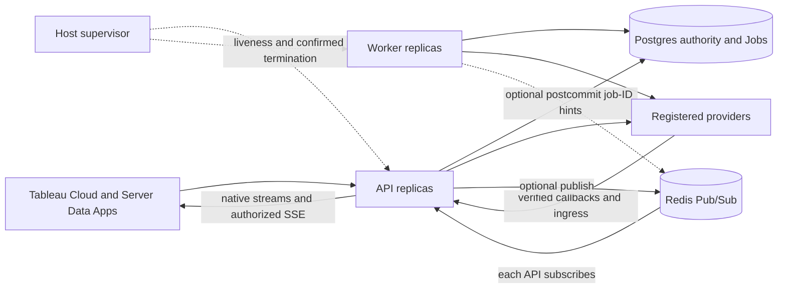
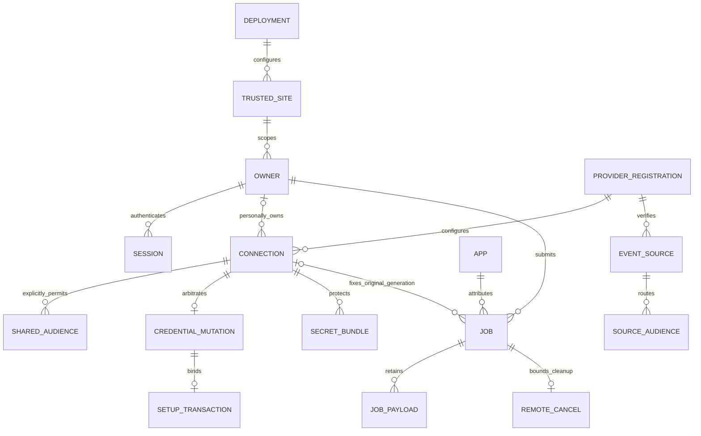
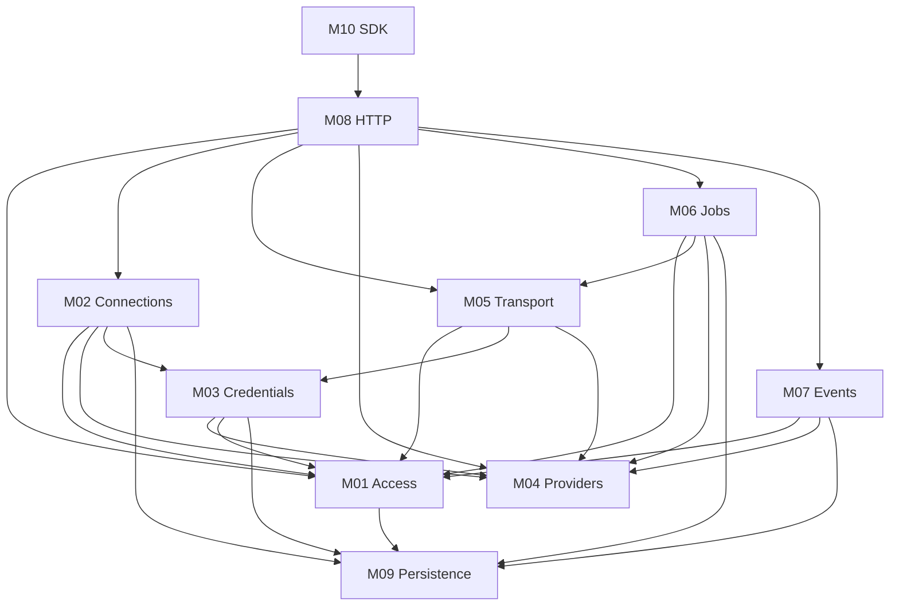

# Architecture

Status: accepted architecture direction with optional-Job and read-only routing revisions integrated.
Owner consistency and viewer checks cover the design; historical independent reviews cover their recorded snapshots.
The application is implemented locally with bounded evidence in [implementation status](implementation.md); no deployment is claimed.
[GOALS](product.md) owns product policy; the specifications below own mechanisms, and [verification](verification.md) owns future proof obligations.

## Application shape

One Node LTS/strict TypeScript/Fastify codebase has two independently replicable roles, initially one API and one worker.
Postgres is authoritative; optional Redis Pub/Sub distributes transient live events.
Correctness must hold with multiple replicas from the start, without a global exclusive authority row or singleton process assumption.

The API owns identity/session transport, native proxy, ordinary capability invocation, connection setup, explicit Job admission/inspection/cancel requests, verified callbacks and local SSE.
The worker owns core session/handoff/mutation maintenance and, when applicable, trusted in-process Job handlers, external observations and Job retention or configured source hooks.
Ordinary capabilities do not require worker dispatch, Job tables or live event transport.
Jobs remains the only queue; bounded Postgres scans/timers and startup/reconnect/capacity-release wakeups recover committed work without a Redis scheduler subscription.
Optional Redis Job hints notify browsers only.
Redis never owns a session, credential, lock, job claim or result.
Disabling events creates no Redis client; a broker outage affects event readiness rather than core API readiness or durable callback processing.

## Ownership and interfaces

The module contracts below own the responsibility map within one codebase.
These are code boundaries, with narrow supplied ports, rather than separate services or mandatory packages.
The composition root statically registers trusted modules and keeps Fastify/Kysely objects out of provider handlers.

## Identity and authority

Only server-verified deployment/site/user identity creates an owner.
Data App authors and users own app behavior; app IDs are configuration, defaults, attribution and submission namespaces, not package authentication.
Personal connections/jobs/events follow owner equality across configured apps, without personal app-use or feature grants.
Shared operator connections require explicit verified-site/user audiences, and personal users cannot administer their secrets.
The protected registry interface remains narrow; adding a site admits verified users but grants no shared connection access.
[Access](access-connections.md) owns session lifetime, handoff and connection authority; the existing Cloud observation has limited scope and does not establish Server support.

[Ordinary snapshots](persistence-operations.md#ordinary-request-snapshots) coherently read current authorization and the matching credential/context bundle without writes or policy shared locks.
Revocation committed before the snapshot denies; an authorized overlapping request may finish.
[Scoped ordered locks](persistence-operations.md#transactions-concurrency-and-failure) remain for mutations, background checkout/start and final saved-result disclosure, including parent locks for absent audience membership.
No database transaction spans provider I/O.
A later disconnect cannot retract that snapshot or bytes already sent; every later operation needs its own current authorization.
Credential publication and original job outcome publication use different predicates so revocation cannot restore secrets or erase eligible results.

## Execution and recovery

Ordinary native requests and named HTTP capabilities run on the API using the same authorization/transport and return HTTP results directly.
Only explicit Job submission selects durable worker execution, saved input/results, progress, recovery and retention.
Capability naming, downloads and response size alone never choose durability.
For deliberate Jobs, first start fixes the execution deadline; a persisted external ID permits observation without another submission.
Lost initial execution ownership, including claim-before-invocation, produces interruption rather than automatic requeue.
A task accepted remotely before its ID is persisted may have an unknown external outcome.
Verified callbacks use Jobs directly, with or without Redis.

Trusted Job handlers initially share the worker process; ordinary capability handlers share their API request process and its normal drain/liveness behavior.
Reserved control scheduling and database capacity handle expiry, cancellation, observations and recovery independently of handler slots.
A never-settling Promise and a blocked event loop require different detection paths: attempt cleanup deadlines and an external host responsiveness watchdog.
Stop claims, force termination when necessary and confirm process exit before reusing its capacity.
Worker-wide replacement can interrupt siblings and delay maintenance; that tradeoff is accepted, with bounded process evidence in [implementation status](implementation.md); deployment recovery remains unverified.
Per-attempt child processes are an extension if mixed-load evidence shows unacceptable disruption, not the initial topology.
[Execution](providers-execution.md) owns claims, cancellation races, external observation and bounded cleanup.

### Worker deployment recommendation

Retain the accepted initial API plus worker topology in this revision: core session/handoff/mutation expiry cleanup and interrupted credential recovery need an owner even without Jobs.
Disable empty Job scans when no configured enabled Job entrypoints accept submissions and no unfinished/retained rows remain; run source hooks only for configured integrations.
Manual event sources and Redis/SSE delivery do not require a background Job executor.
No Job leases, handler slots or Job watchdog checks are readiness prerequisites for ordinary routing/capabilities.
Core maintenance uses bounded due scans and conditional state transitions, not dummy Jobs.

Recommendation, not an adopted topology change: a native-only deployment could run the same bounded core maintenance hooks on API replicas and omit the worker until durable work or source hooks are enabled.
That removes a process but places maintenance scheduling/load and recovery readiness on the API; it needs an explicit deployment choice and evidence that cleanup progresses under request load.
No separate coordinator, scheduler service or new recovery product is needed in either placement.
This recommendation does not change the implemented two-role composition.

## Live events and native streams

Every API subscribes to deployment-scoped Redis channels before it reports event readiness and uses one receive path, including for locally published events.
Published audiences are hints; current source routing/revision, applicable provider event-validity times, session and personal/shared audience are checked before enqueue and logical delivery.
Renewal/source health is distinct from validity of a signed delayed event; maintenance delay cannot extend an actual validity deadline, and subscription expiry is not a universal discard rule.
One logical payload cap, derived encoding budgets, age limits and independent queue limits prevent valid ingress from exceeding a smaller forwarding allowance.
Reconnect clears obsolete buffers and signals possible loss; no archive, durable delivery, second event transport or automatic ambiguous publish retry is added.
[Events and wire contracts](events-http-sdk.md) own these details.

Native HTTP streams use the normal authenticated proxy, with no event envelope or arbitrary total response cap.
The transport preserves encoded bytes and representation headers, supports browser POST carriers for GET/HEAD bodies and exposes provider redirects through an explicit no-follow response carrier.
Maintained libraries enforce approved recipient routing, verified TLS and secret-bearing header protection, including deliberately configured private destinations.
Native provider-created credentials are permitted output; entrusted stored or helper-derived authenticators remain private.

## Operations and support boundaries

Measure large JSON parsing/canonicalization/encryption/driver copies alongside long streams before choosing physical capacity.
Reserve resources before accumulation; authorize before loading saved private Job payloads and recheck their disclosure without long authority locks.
Ordinary HTTP responses retain their request snapshot boundary rather than inheriting saved-result disclosure transactions.
Budget database connections across all replicas, control reserves, maintenance and replacement overlap.
Use one migration owner, compatible code/schema, in-flight HTTP version draining and active Job capability versions; incompatible changes and offline rekey stop all writers and automatic restart.
No selected host, traffic level, SLA, price or slot count is implied.
[Verification](verification.md) maps these contracts to future evidence; design acceptance and document review do not establish operational support.

## Trust and data classification

| Boundary/data | Producer/consumer | Enforcement | Persistence |
| --- | --- | --- | --- |
| Verified identity | Supported Cloud/Server adapter to Access. | Deployment/site/stable subject, never browser claims or email linking. | Minimal owners/sessions and fixed authentication time. |
| Browser authority | Service session to HTTP/Access. | Bearer plus current site/resource checks; null origin is not identity. | Session/proof verifiers, no reusable bearer in jobs/URLs. |
| Registry management | Protected enrollment backend to Access. | Separate registry-only role, no viewer impersonation. | Unique deployment/site and atomic attribution. |
| Entrusted credentials/context | Setup/renewal to Credentials/Transport. | Atomic coherent bundle, current generation and scoped recipient. | Authenticated-encrypted secrets/context. |
| Native result data | Provider to current caller. | Native permissions and narrow entrusted-secret custody exception. | No proxy archive; intentional new credentials may be protected job results. |
| Job data | Submitter/handler to Jobs. | Immutable original account, live claims, current disclosure. | Separate encrypted payloads and indexed metadata. |
| Live events | Verified source through Redis to local SSE. | One payload/age contract and authoritative current audience at logical delivery. | Source configuration only, no payload archive. |
| Operational data | Owners to logs/metrics. | Allowlisted safe fields and protected access. | Host retention, no new analytics platform. |

Operators, installed modules, database and broker administrators remain trusted.
Trusting Data App authors does not grant one viewer another owner's resources or enable arbitrary credential recipients.
No package proof, viewer-equality claim or hostile-app isolation is derived from app IDs or origins.

## Logical state model

This is a logical sketch, not migration DDL or a requirement for separate tables for every label.
Remote cancellation may be bounded fields on Jobs; encrypted payloads remain separate from indexed metadata.
The bounded credential mutation reservation may be connection fields; it arbitrates setup/import/renewal involving providers with one exact expected bundle pair, processor and dispatch phase rather than a separate renewal attempt or work queue.
Strictly local imports prepare/encrypt outside locks, then the same writer atomically checks current authority, exact generations and no competing reservation/uncertainty barrier before publishing; they have no persistent processor lifecycle.
Shared audience parents are lockable even when membership is absent.
No relationship creates a personal app-use grant; app is attribution/default configuration and submission namespace only.
[State ownership](persistence-operations.md#state-ownership) supplies the required fields/constraints.

## Failure boundaries

| Failure | Observable recovery |
| --- | --- |
| Postgres/key unavailable | Fail dependent authority/durability explicitly; no cached allow or local replacement queue. |
| Redis unavailable/disabled | Live loss/degraded events only; durable callbacks and core APIs remain independent. |
| API restart | In-flight native/capability responses and notifications may break, with unknown external effects and no replay; only explicitly durable Jobs have saved state to rediscover. |
| Initial worker claim lost | Interrupted/unknown result without replay, even if invocation might not have begun. |
| Observation claim lost | Reacquire read-only observation of the persisted task without submission. |
| Setup/import/renewal ambiguity | Revision-scoped unusable uncertainty; provider-supported recovery or proven independent explicit replacement, with stale recovery unable to poison newer material. |
| Hung Promise/CPU loop | Attempt cleanup or external liveness timeout stops claims and confirms worker termination; siblings can be interrupted. |
| Midstream/slow client | Bounded cleanup without status replacement or remote rollback claim. |
| Old backup restore | Accepted loss of later local state; external side effects remain. |

## Dependency direction

These arrows represent narrow supplied ports, not permission to import entire owners or create dependency cycles.
M09 implements owner-specific adapters and transaction primitives rather than a generic business-logic superclass.

## Module contracts

### M01 - Access

**Owns:** verified deployment/site/owner mapping, sessions, site registry, explicit shared audiences and current disclosure.
**Input:** supported adapter evidence or presented session/registry proof plus requested resource/configured app context.
**Output:** verified AccessContext/current request snapshot or typed denial, never browser-constructed authority.
**Read path:** M01-M03 supply their predicates to one M09 projection, reused through handoffs without repeated SQL or policy locks for ordinary usable-bundle calls.
**Interfaces:** `authenticate`, `authorizeConnectionUse`, `authorizeDisclosure`, `checkSite`, `registerSite`, `setSiteEnabled` under [Access](access-connections.md).
**State:** owner/session/proof verifiers, deployment/site parents and shared membership; no feature grants or personal app bindings.
**Invariant:** owner equality across configured apps and explicit shared sites/users; app IDs/null origins do not authenticate packages.
**Failure/recovery:** expiry/disablement denies future checks; restoration cannot mint bearer from a cookie for any null-origin requester.
**Extension:** Cloud/Server identity adapters behind one verified identity contract, without local accounts or automatic linking.
**Holds:** D01/E01 returning-client binding and actual Cloud/Server journeys remain unverified; viewer equality is not required.

### M02 - Connections

**Owns:** setup/import, selection, same-account reauth, explicit replacement/disconnect and atomic credential/context association.
**Input:** current personal/operator authority, provider-declared input and optional expected generation/replacement intent.
**Output:** safe connection/attempt view or current ConnectionUse.
**Interfaces:** `begin`, `authorizeLaunch`, `complete`, `importStatic`, `selectVisible`, `reauthorize`, `replace`, `disconnect` under [connection lifecycle](access-connections.md#connection-selection-and-state).
**State:** immutable owner/provider, authority generation, safe account evidence and single-use browser/protocol setup transactions referencing the sole Credentials mutation owner; expected pair/processor state is not duplicated.
**Invariant:** proven same-account reauth can preserve authority generation; unknown/new identity cannot inherit old jobs.
**Failure/recovery:** competing setup/import fails before provider work; stale completion cannot attach, and interrupted possibly-invalidating setup uses revision-scoped recovery without poisoning a newer independent bundle.
**Extension:** shared OAuth/static/operator flows and required context/discovery hooks only.
**Holds:** D08 provider continuity evidence and actual setup/reauthentication tests.

### M03 - Credentials

**Owns:** entrusted authenticators, coherent checkout, shared setup/import/renewal mutation arbitration, dispatch uncertainty and credential generation.
**Input:** internal current ConnectionUse, operation deadline/signal and live claim when applicable.
**Output:** scoped immutable credential/context snapshot or explicit renewal/reauthentication failure.
**Interfaces:** `withCredentials`, `reserveMutation`, `claimMutationStep`, `markMayHaveDispatched`, `publishBundle`, `recoverMutation` under [credential mutation arbitration](access-connections.md#competing-credential-mutations) and [renewal](access-connections.md#refresh-coordination-and-interruption).
**State:** encrypted bundles and one bounded mutation representation for setup/import/renewal with provider interaction; strictly local imports have no persistent processor claim, lease or recovery phase.
Strictly local candidates prepare outside locks, then the same writer checks current authority, exact expected generations and no competing reservation/uncertainty barrier in one atomic publication transaction; stale candidates conflict without replay.
**Invariant:** publication checks current authority and exact captured generations; provider-interacting work additionally requires its current reservation/live processor, while local import requires no competing reservation or uncertainty barrier.
Credentials/context publish together, stale recovery cannot poison newer material, and refresh never resets explicit connector reauth.
**Failure/recovery:** pre-dispatch abandonment preserves the bundle; possible invalidation retains a revision-scoped unusable barrier until provider-supported recovery or proven independent explicit replacement, without locks across network/browser waits.
**Extension:** maintained protocol primitives and narrow supported derived/signing/rotation hooks.
**Holds:** D06 real race/lease tests and D08 provider semantics, not a new topology choice.

### M04 - Provider registry

**Owns:** static definitions, supported schemas/protocols, endpoints, injection strategy and optional HTTP capability handlers/Job entrypoints/source hooks.
**Input:** operator configuration and validated connection context.
**Output:** approved endpoint/strategy descriptors, declared ordinary JSON/native Response or validated background hook data for core publication.
**Interfaces:** `validateRegistration`, `resolveEndpoint`, `parseBundle`, optional `discoverContext`, `invoke` inside the API request, task interpretation and source verification under [providers](providers-execution.md#provider-registration-and-shared-flows).
**State:** immutable revision-keyed code/configuration in memory, no capability execution rows or direct SQL in hooks; drain HTTP calls and retain Job versions only as long as their durable obligations.
**Invariant:** configuration cannot redirect old credentials or create provider permissions; intentional native new credentials remain allowed output.
**Failure/recovery:** unsupported mode/protocol fails explicitly; ordinary abort/error closes its request with no replay, saved outcome or automatic Job promotion; incompatible identity/destination changes fence affected authority.
**Extension:** ordinary providers add declarations/fixtures, and actual protocol differences add narrow reusable hooks.
**Holds:** E03 supported provider facts and active-version upgrade tests.

### M05 - Transport

**Owns:** guarded recipient/TLS/header injection, native byte streaming, no-follow responses, backpressure and the common request/operation/body resource scope.
**Input:** currently authorized native request and coherent endpoint/credential snapshot.
**Output:** native status/useful headers/stream or precommit service error and postcommit body failure.
**Interfaces:** `request` and guarded connector through [native transport](providers-execution.md#native-forwarding-and-transport).
**State:** bounded live bytes/sockets, no ordinary proxy body archive or job receipt.
**Invariant:** no arbitrary credential recipient or automatic business replay; no arbitrary total response cap or full-body buffering.
**Failure/recovery:** abort/stall closes local work without remote rollback; ordinary output remains in its HTTP scope through body completion, and background bodies remain in their attempt scope until disposed.
**Extension:** deliberately configured private providers and justified transport/redirect support with per-hop checks.
**Holds:** D04 native carrier/media/browser/ingress proof and E04 measured physical budgets.

### M06 - Jobs

**Owns:** explicitly requested durable admission, scheduler, execution/observation/cleanup claims, callbacks, cancellation races, retained disclosure and payload ownership.
**Input:** explicit durable choice/current submitter, semantic command/key, original connection generation or verified callback evidence.
**Output:** committed JobView/result or explicit conflict/stale/interrupted outcome.
**Interfaces:** `admit`, `claimStart`, `attachExternalTask`, `observe`, `applyVerifiedCallback`, `listOwnVisible`, `getResult`, `requestCancel`, `recoverDue` under [Jobs](providers-execution.md#durable-admission-and-execution).
**State:** indexed metadata plus separate encrypted payloads; prebound correlation and bounded remote-cancel issued status only for supported hooks.
**Invariant:** Postgres scheduling discovers work without Redis wakeups; no initial-claim replay; current credential revocation differs from eligible original result publication.
**Failure/recovery:** expired initial claims interrupt, persisted external waits resume their supported tracking path, and first eligible terminal commit wins.
**Extension:** static capability/version; per-attempt children only if measured worker-wide disruption requires isolation.
**Holds:** D02/D07 real multi-replica races, host termination and mixed-load proof; accepted sibling interruption is not awaiting product approval.

### M07 - Events

**Owns:** source verification/lifecycle, optional Redis Pub/Sub, current local audience checks and lossy browser SSE.
**Input:** bounded verified provider bytes or postcommit opaque job-ID hint.
**Output:** bounded versioned envelope and current-authority live delivery/drop.
**Interfaces:** `verifyIngress`, `publish`, `subscribe`, `authorizeDelivery`, `maintainSource`, `retireSource` under [Events](events-http-sdk.md#redis-transport-and-live-sse).
**State:** durable source/audience/claim metadata plus transient bounded broker/API queues, never event payload rows.
**Invariant:** disabled means no Redis client; outage affects events only; every API receives through its subscriber and rechecks authority before logical delivery.
**Failure/recovery:** loss/reconnect clears obsolete buffers and signals resync; ambiguous source mutation needs safe recovery or attention.
Source health/renewal deadlines are distinct from provider-specific event validity, checked at ingress/enqueue/delivery independently of delayed maintenance; subscription expiry alone does not discard a valid signed delayed event.
**Extension:** only provider-needed verification/lifecycle hooks; no mandatory dedupe or replay platform.
**Holds:** E02/E04 broker loss/age/encoding/backpressure/ACL and source-uncertainty tests.

### M08 - HTTP adapters

**Owns:** routes, boundary schemas, auth transport, CORS, shared carrier codec/profile, origin/error integrity and streaming handoff.
**Input:** untrusted HTTP with distinct browser, callback, registry and source proof classes.
**Output:** [wire contracts](events-http-sdk.md#proposed-http-surface) and [API map](api.md).
**Interfaces:** thin validated adapters to the owning module; shared login/provider handoff implementation.
**State:** request IDs, bounded parsing/buffers and local transports; no independent domain database.
**Invariant:** CORS/null origins never create identity; adapter-owned provenance marks constructed/transformed output service-origin and unchanged transport pass-through provider-origin.
The shared carrier permits service-origin Responses only on A39; headers/bytes remain consistent and no error instructs automatic replay.
**Failure/recovery:** distinguish service/provider/unmarked HTTP, precommit rejection and late body failure.
**Extension:** shared routes expose new registrations without per-endpoint controllers or approval screens.
**Holds:** D01 restoration binding and D04 actual package/header/media behavior.

### M09 - Persistence and operations

**Owns:** owner-specific Kysely adapters, scoped ordered locks, encryption, resource/pool budgets, migration/readiness/rekey and host lifecycle integration, including the small shared worker execution-lifetime helper.
M05 supplies transport/body disposal; Jobs and Events own their respective domain claims/transitions and can use the helper independently, without a generic task framework.
**Input:** typed owned operations with expected claims/generations and protected configuration.
**Output:** committed or explicit stale/failure result; distinct core/event readiness and liveness.
**Interfaces:** coherent request/read projections, named mutation/disclosure transactions, bounded core maintenance, `migrate`, `readiness`, `reencrypt` under [operations](persistence-operations.md).
**State:** authoritative Postgres schema and protected host keys; no Redis authority or global guard.
**Invariant:** zero-write ordinary snapshots with current mutable authority; fresh database time after waits and parent audience locks for transactions, no large work under authority locks and no zero-row success.
**Failure/recovery:** core expiry/mutation recovery without Jobs, conditional Job/source scans and confirmed host termination for background attempts; compatible overlap or all-writer downtime for incompatible migration/rekey.
**Extension:** concrete owned schema additions and measured capacity changes without a new platform.
**Holds:** D06/E04/E05 real database, whole-deployment pool, shutdown and interrupted-rekey proof.

### M10 - Browser SDK

**Owns:** one thin framework-independent client, shared session/handoff, carrier reconstruction and optional jobs/events.
**Input:** service/app configuration, current verified authority and native request fields.
**Output:** Response/stream and generated safe service-resource types.
**Interfaces:** `request`, `invoke`, `connect`, `importStatic`, `disconnect`, `submitJob`, `listOwnJobs`, `getJob`, `getResult`, `cancelJob`, `subscribe` and proven session methods under [SDK](events-http-sdk.md#embedded-browser-sdk).
**State:** page-local access and explicit submission recovery data; restoration transport remains evidence-dependent.
**Invariant:** no entrusted secret export, automatic business retry, universal provider schema or default whole-body parsing.
**Failure/recovery:** explicit auth/gesture/denial states, resync after event loss and current-owner retained-job rediscovery.
**Extension:** direct package inclusion and framework adapters without another authentication extension.
**Holds:** D01/E01 Cloud/Server sessions and D04 media/carrier evidence.

## Adding work without changing the core

| Addition | Expected edits | Reuse/proof |
| --- | --- | --- |
| Ordinary provider | Declarative schemas/endpoints/protocol and fixtures. | Existing lifecycle/routes/transport; second-provider native proof early. |
| Account-specific destination | Validated context/discovery and routing fixtures. | Atomic bundle publication and guarded connector. |
| Ordinary capability | Versioned input/response and trusted HTTP handler in M04. | Existing request authority/helpers/stream cleanup; no Jobs or persistence. |
| Durable capability entrypoint | Explicit Job handler and only necessary task hooks. | Owned Jobs, original authority, background cleanup and retention. |
| Events | Verified source/routing/setup ownership and necessary hooks. | Optional Redis, one payload contract and current local SSE delivery. |
| Another Data App | Config/defaults/attribution. | Existing personal ownership and explicit operator audience; no personal app-use grant. |

## Decision and engineering status

| ID | Topic | Status | Policy / mechanism summary (linked owners remain authoritative) | Engineering holds |
| --- | --- | --- | --- | --- |
| D01 | Access / SDK sessions | Policy accepted; partially evidenced | Verified Cloud/Server identity, persistent sessions and fixed authentication maximum; no viewer-equality requirement. | Initial cross-client silent-enrollment hardening explicitly deferred; full platform/session/account journeys remain unproved. |
| D02 | Jobs / process architecture | Accepted; contract specified | Explicitly selected Jobs on the owned Postgres table; ordinary capabilities use API requests; replicable roles retain background sibling interruption. | Real replica races, scans, hung-attempt and host termination proof. |
| D03 | Resource protection | Policy accepted; sizing unverified | Physical bytes/memory/socket/pool budgets without app/user/IP/count quotas or future reservations. | Near-cap JSON/crypto/driver copies, mixed workload and total deployment capacity. |
| D04 | Native transport | Accepted; contract specified | Node byte streaming, native GET/HEAD-body and no-follow response carriers, no arbitrary response cap. | Actual Cloud/Server media, header/runtime/ingress/provider proof. |
| D05 | Retained owner disclosure | Accepted; contract specified | Current owner/site/shared audience reads after disconnect, independently of provider usability or app attribution. | Current disclosure races and payload preparation/release proof. |
| D06 | Scoped authority and coordination | Accepted architecture; contract specified | Coherent zero-write ordinary snapshots; ordered mutation/background/disclosure locks, audience parents and live claim/generation predicates. | Real Postgres contention/absence/deadline/replacement races. |
| D07 | Jobs limits and recovery | Policy accepted; contract specified | Fixed first-start deadline, semantic admission, persisted external waits and separate bounded remote cleanup. | Cancellation/callback/send-before-ID/result and recovery tests. |
| D08 | Provider lifecycle | Policy accepted; contract specified | Shared setup, separate authority/credential generations and explicit reauth time, native new-credential output allowed. | Provider continuity/rotation/discovery/static/derived evidence. |

Each D identifier is a navigation summary for the [product policy](product.md) and the linked component contracts above, not a separate policy authority.
Implementation and future acceptance evidence are recorded in [verification](verification.md) and [implementation status](implementation.md).
