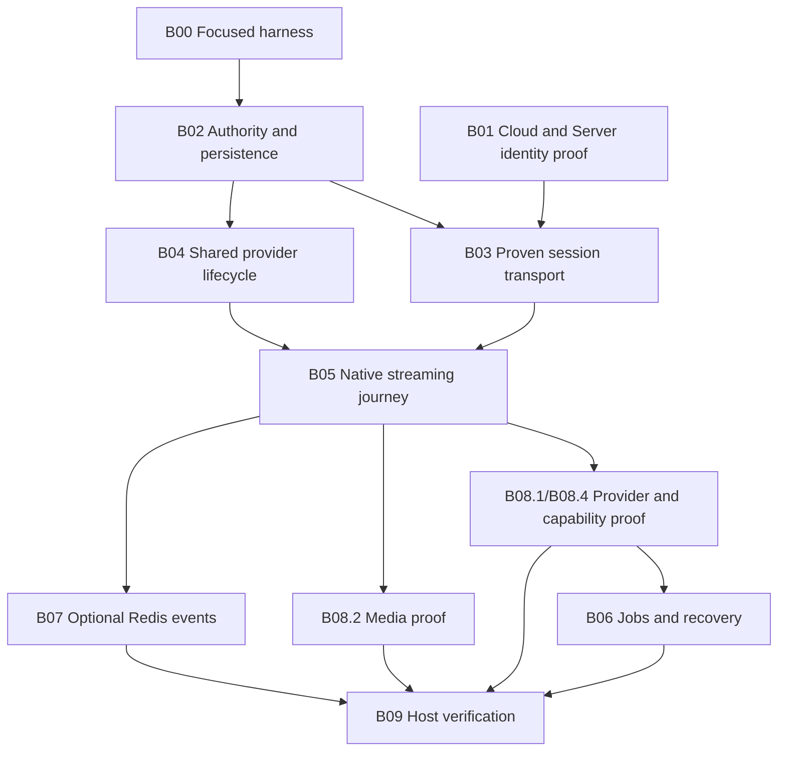

# Build plan

Status: future implementation slices only; this document update authorizes no application implementation or deployment.
All tasks remain unchecked because no application exists.
Each slice consumes its owning contracts and verifies its affected journey; optional features do not block early native-access evidence.

## Dependency map

The B08-to-B06 edge requires only B08.1/B08.4 provider reuse and ordinary capability evidence, not B08.2 media proof.
Media proof remains required for media support and full-product completion.
Actual ingress and host checks begin with B05/B08, then B09 completes operational proof for the implemented features.
B01 can investigate supported identity alongside the fixture foundation; no guessed production endpoint or synthetic production login is permitted.

## B00 - Focused contract and fixture harness

**Owners:** M08/M09/M10 with architecture integration.
**Depends on:** current accepted scope and canonical component contracts.
**Holds:** future implementation authorization; unresolved browser wire surfaces remain explicit.

- [ ] B00.1 Select maintained Node LTS/strict TypeScript/Fastify/Kysely/schema/protocol tools and one source for public resource types, keeping server secret/claim types out of the SDK.
- [ ] B00.2 Build narrow API/worker composition with bounded core maintenance hooks for the first native journey, plus synthetic provider faults; add Job/source execution only in the slices needing it, extending fixtures with later slices.
- [ ] B00.3 Provide real Postgres and actual browser test entrypoints with test-only identity explicitly excluded from production configuration.

**Completion evidence:** runnable focused checks and safe fixture boundaries, not every optional protocol prebuilt.
**Risk:** a fixture proves local behavior only; it cannot certify Tableau or provider support.

## B01 - Cloud and Server identity experiment

**Owners:** M01/M08/M10.
**Depends on:** supported deployment configuration, registration and published Data Apps.
**Holds:** E01 actual adapter/browser evidence; separate Cloud login already has limited historical evidence.

- [ ] B01.1 Document each supported Cloud/Server deployment adapter's official endpoint/registration/identity contract and approved routing.
- [ ] B01.2 Publish the smallest two-owner/two-app journey on both platforms; verify separate authorizing login, site/user identity, opaque package origins, CSP and supported popup/window correlation.
- [ ] B01.3 Demonstrate returning-client restoration binding under reload/new tab/return and blocked/partitioned storage; prove arbitrary null-origin cookie requests cannot obtain bearer access.
- [ ] B01.4 Evaluate silent hardening only when simple and transparent without adverse UX/browser/embed/performance impact; surface concrete tradeoffs otherwise, without a new approval screen or Tableau feature dependency.
- [ ] B01.5 Exercise account separation, concurrent/cross-replica handoff, copied locator, callback mode, expiry/revocation and the fixed verified-authentication maximum; record actual consent/MFA prompts and whether reauth can be silent.

**Completion evidence:** V01 environment/protocol/browser records with exact positive and negative outcomes for each platform.
**Risk:** existing Cloud login proves neither restoration nor Server compatibility; viewer equality is not a requirement and no feature request is assumed.

## B02 - Scoped authority and durable foundation

**Owners:** M01/M09 with Connections/Jobs interfaces.
**Depends on:** B00 and [scoped transactions](../specs/persistence-operations.md#transactions-concurrency-and-failure).
**Holds:** real Postgres validation rather than a global-guard design comparison.

- [ ] B02.1 Create owner/site/session/configuration/connection/shared-audience records and constraints without personal app-use or feature grant tables.
- [ ] B02.2 Implement one coherent ordinary authorization/bundle read with zero logical writes or policy shared locks; retain ordered mutation/background/disclosure locks, audience parents, fresh post-wait time, bounded waits and explicit zero-row outcomes.
- [ ] B02.3 Implement the [site-access slice](../openspec/changes/tableau-site-access/tasks.md) with its existing narrow registry role and atomic attribution.
- [ ] B02.4 Implement standard authenticated encryption and minimal migration/config/schema/key readiness; add safe logs and measured pool budgeting across replicas/control/overlap.

**Completion evidence:** V02/V08/V11 scoped absence/revoke/checkout races, current owner/shared access and tamper/startup failure checks.
**Risk:** no large validation/encryption, payload loading or network work under authority locks.

## B03 - Proven service session transport

**Owners:** M01/M08/M10.
**Depends on:** B01/B02 and its demonstrated returning-client binding.
**Holds:** A07 final wire details cannot be guessed from a cookie candidate.

- [ ] B03.1 Implement the verified adapter, shared login/provider transaction handoff and stable session/access renewal contract across API replicas.
- [ ] B03.2 Enforce fixed authentication time, current site/identity separation and page-local cleanup without signout UI or feature/app permission grants.
- [ ] B03.3 Repeat published Cloud/Server positive and adversarial session journeys against the actual implementation, keeping business replay absent during renewal.

**Completion evidence:** V01 against actual service, including copied/wrong-window proof, null-origin requester and true expiry versus ordinary access renewal.
**Risk:** a supported separate login alone does not satisfy convenient secure restoration.

## B04 - Provider setup and shared credentials

**Owners:** M02-M05/M09.
**Depends on:** B02; B03 for the real browser setup journey.
**Holds:** E03 evidence for the declared provider protocol/continuity semantics.

- [ ] B04.1 Implement static declarations, shared OAuth/static/operator/derived setup and one guarded maintained transport for token/discovery/renewal/proxy calls.
- [ ] B04.2 Implement the shared Credentials writer: strictly local imports prepare/encrypt outside locks and publish through one current-authority/exact-generation/no-competing-reservation transaction; provider-interacting setup/import/renewal retains the sole durable mutation owner, dispatch uncertainty and revision-scoped recovery.
- [ ] B04.2a Verify atomic local publication, stale/conflict rejection and lost-response behavior without automatic replay; preserve separate generations and explicit connector-reauth time with no invented periodic default.
- [ ] B04.3 Implement live mutation/processor/revision dispatch and publication predicates, cumulative possible invalidation and revision-scoped recovery for interrupted setup/import/renewal; prove pre-dispatch preservation and safe independent replacement without network locks.
- [ ] B04.4 Exercise known/non-expiring/unknown/static/derived credentials, omission/rotation semantics, same-account reauth and unknown/new replacement, shared audiences, disconnect and protected custom checkout.

**Completion evidence:** V03/V04 real lifecycle/race fixtures and no entrusted-secret disclosure, while intentional native new credentials remain allowed.
**Risk:** provider ACLs cannot be inferred from desired configuration or replaced by service feature grants.

## B05 - Native streaming proxy journey

**Owners:** M05/M08/M10.
**Depends on:** B03/B04; scoped real Postgres authority checks.
**Holds:** D04 actual ingress/package/provider transport evidence.

- [ ] B05.1 Implement [native streaming tasks](../openspec/changes/native-response-streaming/tasks.md), low-level encoded byte forwarding/backpressure and shared request/response carrier codec/profile.
- [ ] B05.2 Use Slack for the first real native/provider tests and exercise personal/shared/no-credential modes, browser-selected raw/multipart uploads and intentionally configured private provider routing without metadata/control access.
- [ ] B05.3 Test native methods/errors/paging/ranges/encoded bodies, GET/HEAD-body carriers, inspectable no-follow 3xx, actual header limits, late failure and cleanup without replay.
- [ ] B05.4 Measure generated large transfers and simultaneous streams with actual ingress; no arbitrary response cap, whole-body buffering or healthy-stream total timeout.

**Completion evidence:** V05 through service/SDK/published Cloud and Server paths, with current support limits recorded honestly.
**Risk:** primitive carrier/gzip/header probes are not this application's integration proof.

## B08 - Provider and capability proof with independent media proof

**Owners:** M04/M05/M10 with architecture review.
**Depends on:** B05; no jobs/events prerequisite for native extension evidence.
**Holds:** real media authorization/consumption and supported provider facts.

- [ ] B08.1 Add a second ordinary provider with account-specific context using only declarations and necessary hooks; verify existing provider behavior remains unchanged.
- [ ] B08.2 Prove actual authenticated image/video/download consumption and ranges in Cloud/Server without arbitrary credential destinations, reusable query bearer or whole-video Blob conversion.
- [ ] B08.3 Exercise app-directed read from one provider and write through another, under independent current connection authority.
- [ ] B08.4 Add the ordinary capability invoke route/SDK method and a small provider-handler fixture using the existing request helpers; prove direct JSON/native streaming, abort/error/unknown outcome, no Job writes and no separate policy with V14.
- [ ] B08.5 Record a Slack how-it-works recipe with its exact bespoke capability still unselected; native provider and ordinary capability support must not depend on durable Jobs/events.

**Completion evidence:** V03/V05/V14 native extension, ordinary capability and media journeys with small justified core change footprint.
**Risk:** universal provider SDK/transport compatibility is not implied.

## B06 - Durable jobs and worker recovery

**Owners:** M06 with M01/M03/M04/M09.
**Depends on:** B02/B04 and B08.1/B08.4 native provider reuse and ordinary capability evidence; B08.2 media proof is independent of core Jobs.
**Holds:** runtime race/host/resource proof, not queue-library or sibling-interruption policy selection.

- [ ] B06.1 Implement separate indexed metadata/encrypted payloads, semantic opaque-key admission and current disclosure recovery before new connection/resource selection.
- [ ] B06.2 Implement bounded authoritative Postgres scans, earliest-due timers, startup/reconnect/capacity-release wakeups and reserved control resources; add fair observations only for supported observation hooks, with no Redis scheduler subscription or fixed scan interval chosen here.
- [ ] B06.3 Implement live claim/incarnation/lease/generation predicates, first-start deadline and no automatic interrupted-handler replay, including claim-before-invocation.
- [ ] B06.4 Deliver required external-task support using a complete tracking/recovery path for the selected integration: persist task identity, release execution capacity, preserve eligible original outcomes after disconnect and report send-before-ID uncertainty without resubmission; callback prebinding or documented lookup/redelivery applies only to supported callbacks; read-only observation applies only to supported observation hooks, and the chosen integration must not leave both tracking paths unsupported.
- [ ] B06.5 Implement local cancellation/deadline/terminal races for all Jobs; implement separate bounded remote-cancel issued status and late-task-ID cleanup only for supported remote-cancel hooks, without uncertain replay or retained revoked credentials.
- [ ] B06.6 Use M09's small worker execution-lifetime helper with M05 transport disposal, adding it here only if B07 has not already needed it; confirm host exit before capacity reuse for hung Promise/CPU loop and expose sibling interruption.
- [ ] B06.7 Run two APIs/two workers against real Postgres with process faults, absent notifications/lost responses, near-cap JSON/results and authentication plus supported callback/observation latency measurement.

**Completion evidence:** Core Jobs proves durable admission, worker execution, first-start deadline, no interrupted replay, local cancellation and retained reads through V06/V07/V08/V12/V13.
Full-product completion also requires B06.4 external-task tracking/recovery; callback/observation/remote-cancel cases apply only to declared supported hooks, and media evidence remains independently required under B08.2.
**Risk:** a timeout Promise or terminal DB row does not stop live code, and no runtime proof is supplied by this design.

## B07 - Optional Redis notifications and sources

**Owners:** M07 with M01/M04/M06/M08-M10.
**Depends on:** authority/wire foundations B05; no durable-Job prerequisite for native events.
Configured service-managed hooks use M09's small worker execution-lifetime helper and M05 disposal while M07 owns source claims/state; create that helper in whichever of B06/B07 first needs it, without business Job implementation or Job rows.
**Holds:** actual Redis security/buffer/reconnect and provider verification evidence.

- [ ] B07.1 Implement disabled mode with no Redis client/dependency, and enabled mode with one subscriber receive path per API plus bounded publisher access.
- [ ] B07.2 Preserve useful native payloads under one logical cap with computed envelope/base64url/SSE budgets and trusted age/skew; batch immediate enqueue/delivery authorization, rechecking after any queue/wait rather than imposing hint-only data.
- [ ] B07.3 Implement independent slow-client queues, bounded decode work, no offline publish queue or ambiguous auto-retry, resubscribe/resync and core/event readiness separation.
- [ ] B07.4 Implement source verification/setup ownership and only the enabled provider's required lifecycle hooks, with dispatch uncertainty and revision fencing; distinguish renewal/health from provider-specific event validity at ingress/enqueue/delivery independently of delayed maintenance.
- [ ] B07.5 Run distributed subscriber/publisher/broker failures, audience races, encoded boundaries, age/skew and callback independence tests; no database event relay or replay path remains.

**Completion evidence:** V09/V10 with healthy/slow/offline clients, useful native payloads and no Job dependency; when Jobs are enabled, their callbacks remain correct during broker outage.
**Risk:** acknowledgement is best-effort forwarding acceptance, not delivery or retained history.

## B09 - Host and operational verification

**Owners:** M09 and affected owners.
**Depends on:** selected host and implemented supported slices; ingress proof already begins in B05/B08.
**Holds:** E05 actual supervisor/key/database/broker configuration and drills.

- [ ] B09.1 Verify core expiry/mutation maintenance with Jobs/events absent, conditional scans/hooks and separate readiness; verify worker control/termination only for background execution and normal API drain/liveness for ordinary capabilities.
- [ ] B09.2 Validate whole-deployment memory/socket/database/broker budgets with near-cap JSON, streams, callbacks and source/claim recovery; choose tuning from measurements.
- [ ] B09.3 Reuse the owning behavioral scenario evidence and its path-level interaction measurements, retaining zero-write usable ordinary requests and no per-chunk/event-body persistence without exact SQL/helper/table-shape assertions; rehearse install/upgrade/failure, HTTP draining and active Job version compatibility, incompatible all-writer downtime and interrupted one-envelope offline rekey with automatic restart disabled.
- [ ] B09.4 Run relevant lint/type/build/security/browser checks on actual code and document supported platform/provider/host behavior plus remaining limits.

**Completion evidence:** V11/V12 and all gates for released journeys, with actual environment/fault logs and no secrets.
**Risk:** no architecture guarantees a finding-free security audit, support level, throughput or SLA.

## Ownership and handoff

The architecture owner integrates shared contracts; workers build authorized slices with owned files/interfaces/invariants/failure tests named explicitly.
Routine private names/library versions/tuning are engineering choices within accepted behavior, not repeated product approval requests.
Only mark implementation tasks complete with observed evidence, and preserve historical review scope separately.
OpenSpec documents remain unarchived until their implementation and required review/evidence are complete.
