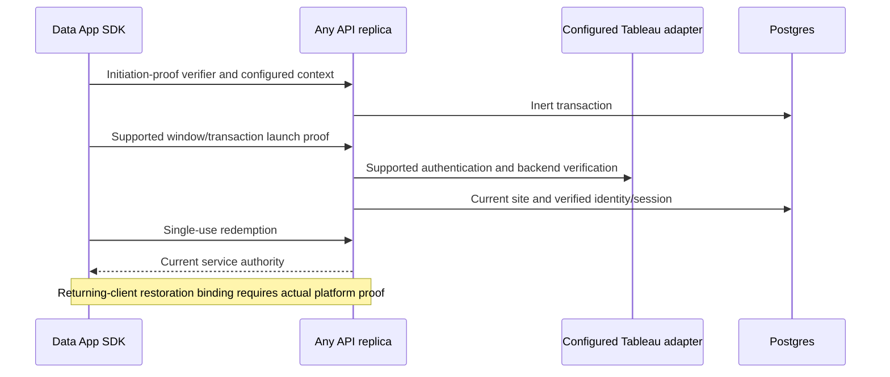
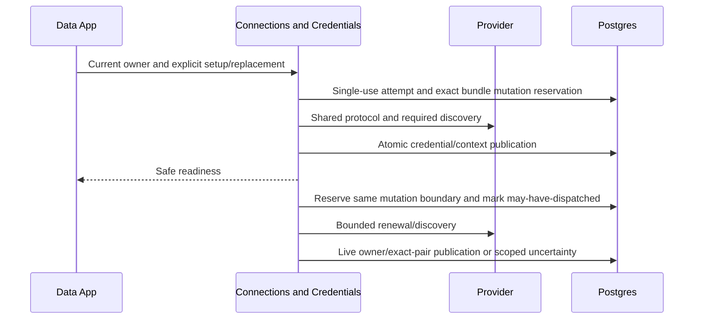
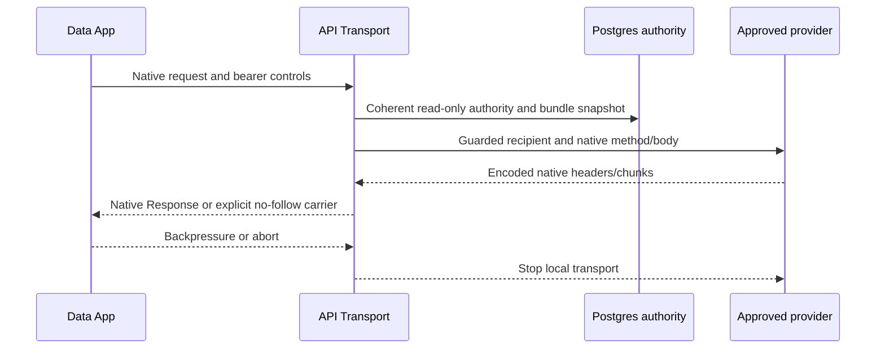
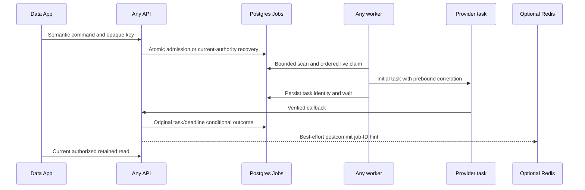
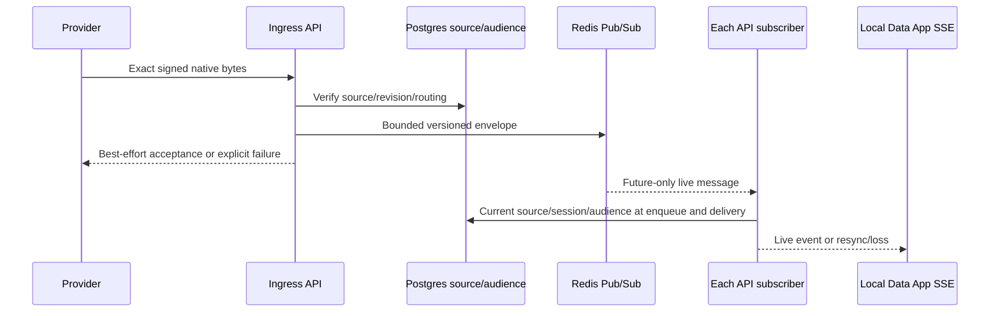
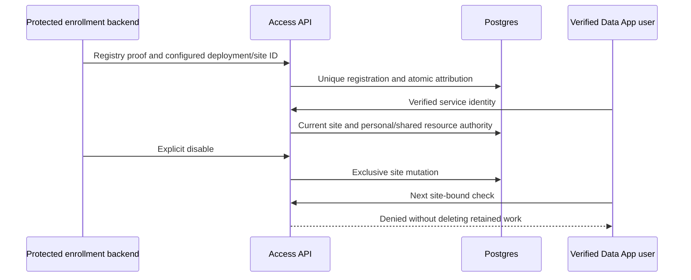

# Data flows

Status: seven maintained journey maps for the accepted architecture, not implemented executions.
Tables trace payload, authority, durable state and recovery to the owning contracts without defining alternative policies.
App IDs always mean configured defaults/attribution or submission namespace, never personal feature grants.

## F01 - Establish and restore service identity

Purpose: obtain a verified owner/site session and restore it securely across supported return journeys.
Status: fixed authentication policy accepted; Cloud separate login partially evidenced, full Cloud/Server transport unverified.
Modules: M01, M08, M09, M10.
Routes: A01-A05 and A07.
Owner: [Access session contract](../specs/access-connections.md#recommended-session-prototype).



| Step | From -> to | Data carried | Authority / durable effect | Failure or unresolved detail |
| --- | --- | --- | --- | --- |
| 1 | User -> Data App | Explicit gesture for supported login window. | No backend identity yet. | Popup/opener restrictions need Cloud/Server proof. |
| 2 | Data App -> API | App/deployment config and random proof verifier. | Inert expiring Postgres transaction, not authentication. | Bounded actual allocation; no IP/count quota. |
| 3 | Opener -> service window | Initiation proof and transaction/window correlation. | Opener verifies service origin/window; service validates supported correlation. | Null origin cannot identify the package; locator alone cannot launch. |
| 4 | API/browser -> Tableau | Supported state/PKCE/nonce/callback evidence. | Backend verifies deployment/site/stable subject. | No invented endpoints or viewer-equality prerequisite. |
| 5 | API -> Postgres | Verified owner/site and authentication time. | Current enabled site, fixed maximum and shared replica session state. | Wrong/disabled site denies, regardless of email. |
| 6 | API -> Data App | Safe completion and single-use proof redemption. | Current bearer returned only to bound initiator, never URL. | Copied/wrong-window/duplicate redemption fails. |
| 7 | Returning Data App -> API | Demonstrated returning-client/session binding. | Current identity/site and fixed authentication expiry rechecked. | OPEN: A07 transport proof; cookie plus arbitrary null-origin proof is insufficient. |
| 8 | Data App -> local resources | Page closure or deliberately established new account. | Clear page authority/views/listeners appropriately. | No service signout, provider disconnect or job cancellation from page closure. |

## F02 - Connect a provider and obtain usable credentials

Purpose: publish one coherent account/credential/context bundle and renew without stale revival.
Status: setup/generation/uncertainty contracts specified; actual provider/browser evidence required.
Modules: M01-M05, M08-M10.
Routes: A08-A17 and A36, with protected operator setup outside viewer routes.
Owner: [Connections and Credentials](../specs/access-connections.md#provider-authorization-transaction).



| Step | From -> to | Data carried | Authority / durable effect | Failure or unresolved detail |
| --- | --- | --- | --- | --- |
| 1 | Data App -> API | Declared input and expected-authority intent. | Current owner/operator; existing connection captures exact bundle pair and reserves shared mutation boundary. | Competing setup/import/renewal returns conflict before provider work; no app-use binding. |
| 2 | Browser/API -> provider | Bound handoff or protected static import. | Supported protocol, original owner/session and finite attempt. | No fabricated OAuth for static secrets or copied-locator launch. |
| 3 | Provider -> API | Correlated code/response. | Fresh live exchange processor under the same logical reservation and expected pair. | True session/attempt expiry ends it with scoped recovery; normal access renewal preserves binding. |
| 4 | API -> provider | Exchange/validation and required context discovery. | Commit possible dispatch/invalidation before external work; approved recipient outside locks. | Earlier invalidation evidence persists through discovery/browser waits and blocks old-bundle checkout. |
| 5 | API -> Postgres | Validated encrypted bundle and account evidence. | Live reservation/processor and exact expected pair; same-account reauth preserves authority generation and advances credential/reauth data. | No stale revision rebasing; unknown/new identity advances authority and cannot inherit old jobs. |
| 6 | API -> Data App | Safe status, account label and endpoint readiness. | Current owner/shared disclosure only. | No entrusted secret/context export; native new credentials are separate permitted data. |
| 7 | API or worker -> Postgres | Need current usable bundle. | Renewal reserves the same per-connection boundary after rereading current bundle. | Release pool connection between bounded waits; setup/import may own the reservation or already have published. |
| 8 | API or worker -> provider | Renewal after committed may-have-dispatched. | Live authority/claim and coherent snapshot. | Lease expiry is not proof that rotation did not happen. |
| 9 | API or worker -> Postgres | Complete bundle or interruption recovery. | Live mutation owner/processor and exact expected pair; only matching possibly invalidated bundle becomes uncertain. | Pre-dispatch failure preserves old bundle; stale recovery cannot poison newer independent material or revive disconnect; no replay. |

## F03 - Native request and large streamed response

Purpose: preserve native provider HTTP while bounding live resources.
Status: carriers and byte semantics specified; actual Cloud/Server media/ingress/provider behavior unverified.
Modules: M01-M05, M08, M10.
Routes: A18 and evidence-dependent A37.
Owner: [Transport](../specs/providers-execution.md#native-forwarding-and-transport) and [wire](../specs/events-http-sdk.md#native-request-carrier).



| Step | From -> to | Data carried | Authority / durable effect | Failure or unresolved detail |
| --- | --- | --- | --- | --- |
| 1 | Data App -> API | Native method/query/body and bounded controls. | Current bearer; SDK/server shared codec checks. | GET/HEAD body automatically carried by POST; no whole-file conversion. |
| 2 | API -> Postgres | Current site/owner or shared audience and bundle. | One coherent read, zero logical writes or policy shared locks for a usable bundle; no Job row. | Revoke committed before snapshot denies; authorized overlap may finish. |
| 3 | API -> provider | Native request with injected entrusted credentials. | Socket-time recipient/TLS, approved context and deliberate private routes. | Input cannot redirect credentials to arbitrary/metadata/control destinations. |
| 4 | Provider -> API | Raw encoded status/headers/body. | Filter transport/entrusted-secret exceptions, preserve native created credentials. | No automatic decompression/following or generic response scanner. |
| 5 | API -> Data App | Incremental native body or 3xx/tunneled-HEAD carrier. | One browser decoding pass; bounded bytes/sockets, no arbitrary total response cap. | Header profile and actual ingress limits must be measured. |
| 6 | Data App -> API -> provider | Slow consumption/abort/disconnect. | Backpressure and bounded disposal. | Local stop does not undo remote effects. |
| 7 | Provider/network -> API -> Data App | Preheader or late body failure. | Precommit service error or postcommit termination. | No appended JSON, invented success or business replay. |
| 8 | Data App -> approved media resource | Native file URL/authorized consumption. | OPEN: actual media-element/download authorization and route proof. | No arbitrary URL authority, reusable query bearer or whole-video Blob workaround. |

## F04 - Managed job, external task and result recovery

This flow is deliberately selected through A20; capability naming, a download or a large response never selects it automatically.

Purpose: admit once, execute with original authority and resume observation independently of browser/Redis lifetime.
Status: accepted owned scheduler and worker interruption boundary; real races/host proof outstanding.
Modules: M01, M03-M10.
Routes: A19-A24 and A27.
Owner: [Jobs](../specs/providers-execution.md#durable-admission-and-execution).



| Step | From -> to | Data carried | Authority / durable effect | Failure or unresolved detail |
| --- | --- | --- | --- | --- |
| 1 | Data App -> API | Opaque key, version/input and connection choice. | Current submitter; validated semantic command and resolved policy limits. | No UUID-only grammar or caller cap override. |
| 2 | API -> Postgres | Comparison/encrypted input and original identity. | Recover equal row before selection/new allocation; unique atomic new admission. | Actual failure is explicit, no pending-job quota or future-result reservation. |
| 3 | API -> Data App | 202 new or 200 retained JobView. | Durable acceptance only after commit. | Lost response uses same command/key, not new logical submission. |
| 4 | Worker -> Postgres | Candidate hint then ordered current start checks. | Token/incarnation/lease and first-start deadline; no browser-session dependency. | Permanent replaced authority fails, freshness can wait; scans do not depend on hints. |
| 5 | Worker -> provider | Trusted initial handler with persisted callback binding. | Original account/current checkout and live deadline. | Send-before-ID can leave unknown effects; no automatic replay. |
| 6 | Worker -> Postgres | External ID/context or terminal output. | Live conditional commit; cleanup before slot reuse. | Lost initial claim interrupts, while persisted external wait survives. |
| 7 | Provider -> API or worker -> provider | Verified callback or read-only observation. | Original binding, fresh deadline and first terminal outcome. | Redis independent; observation never submits; cancellation/deadline races remain fenced. |
| 8 | API/worker -> Postgres then Redis -> APIs | Committed result followed by optional job-ID hint. | Durable truth before lossy notification; each API rereads current state/audience. | Broker loss cannot roll back callback/result or strand queued work. |
| 9 | Returning Data App -> API | Own-job keyset collection/status/result. | Current owner/site/shared disclosure across configured apps, including disconnect. | Auth before payload load and recheck before release; no new credential use. |
| 10 | Worker control -> Postgres | Due deadline/cancel/claim/retention scans. | Reserved control capacity, immutable terminal time and separate bounded remote cleanup. | No slot starvation, uncertain cancel replay or active-job age deletion. |

## F05 - Verified live events to Data App browsers

Purpose: distribute optional private notifications across API replicas with explicit live loss.
Status: Redis replacement and payload/age/audience contracts specified; broker/browser tests unrun.
Modules: M01, M04, M07-M10; M03 plus shared bounded worker scope only for configured service-managed hooks; no business Job prerequisite.
Routes: A25-A26, with source setup through declared owner/A18 where supported.
Owner: [Events](../specs/events-http-sdk.md#redis-transport-and-live-sse).



| Step | From -> to | Data carried | Authority / durable effect | Failure or unresolved detail |
| --- | --- | --- | --- | --- |
| 1 | Declared setup owner -> provider | Manual/app/service source setup. | Protected source association and only necessary claimed hooks. | Browser closure does not retire provider-wide source; uncertain mutation needs recovery/attention. |
| 2 | Provider -> API | Bounded raw bytes/headers/challenge. | Supported signature/replay verification. | Payload IDs are locators, never audience authority. |
| 3 | API -> Postgres | Verified source and revision. | Current configured personal/shared routing. | Retired/replaced association cannot be revived by payload or stale cache. |
| 4 | API -> Redis -> every API | Versioned source/age envelope and encoded native payload. | One logical payload cap with computed overhead; one receive path even locally. | Offline/ambiguous publish is not retained/retried; unavailable forwarding fails honestly. |
| 5 | API -> local Data App | Authorized logical SSE event. | One current read may cover immediate enqueue/release; queued delivery requires fresh source/session/site/owner/shared checks. | Independent queues/drop/stall handling; no recall of released bytes or mandatory dedupe. |
| 6 | Data App -> API | Current authority on reconnect. | Re-subscribe for future events and resync-required; no archive. | Clear obsolete queues, bound age/skew, true denial stops recovery. |
| 7 | Data App -> API -> provider | Explicit current-state fetch or retained Jobs read. | Ordinary current authority. | Some missed events cannot be reconstructed; no automatic business orchestration. |

## F06 - Add a Tableau site and enforce a later disable

Purpose: retain the narrow enrollment interface while admitting verified Cloud/Server sites without broadening resource audiences.
Status: registry contract specified; deployment adapter continuity and race proof required.
Modules: M01, M08, M09.
Routes: A31-A33.
Owner: [Registry](../specs/access-connections.md#trusted-site-registry-administration).



| Step | From -> to | Data carried | Authority / durable effect | Failure or unresolved detail |
| --- | --- | --- | --- | --- |
| 1 | Enrollment backend -> API | Registry-only credential and deployment/site ID. | Separate protected management role. | No browser/email authority or new approval UI. |
| 2 | API -> Postgres | Validated configured deployment/site and safe attribution. | Unique atomic entry; duplicate preserves disabled state. | No arbitrary issuer/discovery or identity migration through URL edits. |
| 3 | Verified Data App -> API | Supported deployment/site/user identity. | Enabled-site eligibility, then owner/shared audience checks. | New site inherits no shared connection access. |
| 4 | Enrollment backend -> API -> Postgres | Explicit enabled=false. | Ordered exclusive parent mutation and committed attribution. | Failure cannot report successful disablement. |
| 5 | API/worker -> Postgres | Later restore/start/checkout/disclosure/delivery. | Ordinary snapshot denies when disable committed before it; transactional start/disclosure uses the common lock order. | Already-started eligible outcomes may persist; no credential resurrection or forced revoke cancellation. |

## F07 - Invoke reusable provider code through ordinary HTTP

Purpose: reuse trusted provider-specific logic without retaining a command or outcome.
Status: ordinary request contract specified; implementation and API-handler resource behavior remain unverified.
Modules: M01-M05, M08-M10, without M06.
Routes: A19 discovery and A39 invocation; A20 is a separate deliberate durable choice.
Owner: [Ordinary capability invocation](../specs/providers-execution.md#ordinary-capability-invocation).

```mermaid
sequenceDiagram
  participant App as Data App SDK
  participant API as API and registered handler
  participant DB as Postgres authority
  participant P as Approved provider
  App->>API: A39 declared input and connection control
  API->>DB: Coherent current request snapshot
  API->>API: Validate arguments and invoke trusted code
  API->>P: Shared authenticated helper
  P-->>API: Native response
  API-->>App: Declared JSON or HTTP stream
  Note over App,API: Abort/error ends HTTP scope; no Job or saved result
```

| Step | From -> to | Data carried | Authority / durable effect | Failure or unresolved detail |
| --- | --- | --- | --- | --- |
| 1 | Data App -> API | A19 capability reference and supported HTTP/Job modes. | Current configuration discovery, no capability grant. | No HTTP entrypoint means explicit unsupported behavior, never Job fallback. |
| 2 | Data App -> API | A39 declared JSON arguments or native body and connection control. | Current service authority; validate declared input form and measured parser/stream capacity. | No submission key, durable admission, input encryption or hidden retention. |
| 3 | API -> Postgres | Session/site/registration/selection/audience and matching bundle. | Coherent read-only snapshot; zero writes for usable credentials, bound original account. | Revoke-before-snapshot denies; ordinary overlap may finish; refresh uses shared mutation only if needed. |
| 4 | API -> provider | Request-scoped authenticated helper/native request. | Reuse first immediate snapshot; later provider operations require fresh current authority for the same connection. | No started-Job session-expiry exception, default-account substitution or automatic replay. |
| 5 | Provider -> API | Native status/body or data for the declared JSON result. | Shared custody, native errors and bounded intermediate-body handling. | No mandatory result schema for native streams or artificial data-free capability rule. |
| 6 | API -> Data App | Declared JSON or streamed HTTP Response. | Request scope owns body until consumed/closed; no saved-result disclosure transaction. | Late failure terminates body; no JobView/progress/result URL or implicit durable success. |
| 7 | Data App/API -> local transports | Abort, disconnect, failure or shutdown. | Dispose request resources; normal API drain/liveness, no Job lease or recovery scan. | Provider effects may be unknown; explicit durable execution would have needed A20 from the outset. |
